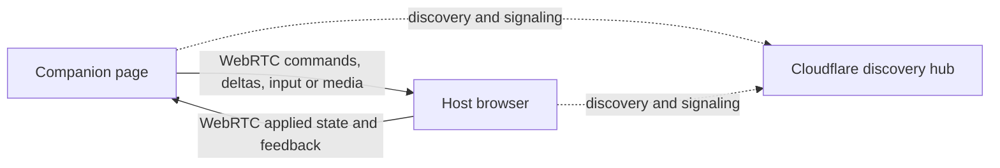

# Application patterns

AIUI supports applications ranging from static scientific reports to desktop
tools with several compute services. Five application patterns establish the
common arrangements. Credentials, tablet input, companion devices, and AI
workflows compose across those arrangements.

This repository is a place to develop the patterns and demonstrate them. An
application may begin here and move to its own repository. Toolkit support can
take the form of a library, a small helper, a configuration recipe, or a working
example; a pattern does not require a framework abstraction or a permanent
application in this repository.

The conventions below record the current direction. Links identify existing
implementations and experiments. The
[public site with optional login spike](./public-site-optional-login-spike.md)
is a brief for a future session.

## Application patterns at a glance

| Pattern | Application execution | Development | Delivery |
| --- | --- | --- | --- |
| Self-contained browser application | Browser, including local computation | Vite and source dependencies | Static files |
| Browser application using SaaS | Browser and real external services | Vite connects to those services | Static files, with credential infrastructure as needed |
| Browser application with custom services | Browser and application-owned backends | One launcher starts Vite and local services | Site gateway and independently hosted services |
| Portable application packaged with Electron | Browser-compatible frontend and bundled local compute, plus remote services | Vite inside Electron and a shared service launcher | Desktop bundle; the frontend also supports web deployment |
| Desktop application built around Electron | Frontend, local compute, and desktop capabilities | Shared development infrastructure plus Electron main and preload | Desktop bundle with an application-specific shell |

These are recipes that can be combined. A desktop application can use bundled
Python, a deployed Worker, and a commercial SaaS service together.

Prefer browser computation and peer communication when they meet the need.
When hosted application logic is needed, prefer Cloudflare Workers where they
fit; use custom runtime backends for work that benefits from them. The chosen
arrangement should keep deployment and local development straightforward.

## 1. Self-contained browser application

Static files supply the application, and its application logic runs in the
browser. Reports, scientific inquiries, visualizations, and the gallery before
its service-connected AI toolbar illustrate this pattern. Static delivery can
include substantial computation through browser workers, WASM, or local data
engines.

Development uses Vite and consumes the source of closely developed dependencies.
Editing an imported dependency should follow the application's normal update
path without a separate library build.

Delivery can use S3-like storage, R2 behind a serving Worker, or Cloudflare Worker
Static Assets. The site may be public or protected by Cloudflare Access. A Worker
whose only role is serving files or enforcing entry to the site does not change
where the application computation runs.

Existing support includes the [frontend playbook](../../packages/aiui-viz/docs/frontend-playbook.md),
the [source-first workspace guide](../../packages/aiui-build-config/docs/source-first-workspaces.md),
and the [gallery](../../demos/gallery).

## 2. Browser application using SaaS

A statically delivered frontend connects to external services such as MotherDuck
or AI providers. The normal development loop connects to the real service,
possibly using a development account or instance. It does not need to launch a
local imitation of that service.

Credential acquisition has three supported approaches:

- A credential broker supplies short-lived credentials, using the provider's
  supported minting or federation flow.
- Development tooling supplies explicitly selected keys from the local
  environment. The existing Vite `devKeys` option reads environment variables;
  the repository's `.env` and direnv setup is one way to supply them.
- The user pastes a key, which the application can retain in local storage.

User-pasted keys are an accepted workflow. Development injection deliberately
makes the selected key available to the development page; it is a dev-only
option. Credential sources remain separate from the component that uses the
service. Provider-specific adapters handle acquisition and renewal where needed.

A shared credential broker is supporting infrastructure, even when an
application has no custom domain backend. The existing machine access flows
through Cloudflare Mesh belong alongside browser login as ways of reaching and
authenticating to that infrastructure. They need not all become the same login
experience.

SaaS connections may go directly from the browser to the provider when its
browser API permits it. They need not be routed through the application's
gateway merely for uniformity. Connecting to real services in development also
leaves room for fixtures in automated tests.

Existing examples are the [credential adapters](../../packages/aiui-cf-creds/README.md),
[development key injection](../../packages/aiui-source-processor/README.md), and
[MotherDuck lab](../../demos/motherduck-lab).

## 3. Browser application with custom services

The application owns backend logic, commonly in the same repository as the
frontend. Backends may be a Cloudflare Worker, Python, Express, or another
runtime. The backend Worker provides application services and is separate from
the Worker serving the site.

One development command starts the frontend and its local services. The launcher
owns startup, readiness, and shutdown. Each listening service binds an available
port and reports its actual address; frontend code uses stable application paths
such as `/api/python`, rather than embedding those addresses. An Express app
can alternatively run as middleware without a separate listener. A local Worker
runtime's adapter reports its address on behalf of the Worker.

The small readiness convention demonstrated by DevStack is:

```json
{"type":"dev-ready","url":"http://127.0.0.1:43827/"}
```

The service emits this newline-terminated record after binding and initializing.
The supervisor receives an address and a cleanup operation. Backend-specific
launch details stay in adapters, so application code does not need to learn the
frontend's port.

| Environment | Browser-facing route owner | Backend placement |
| --- | --- | --- |
| Development | Vite middleware and proxies | Local processes and a local Workers runtime; remote services when selected |
| Hosted deployment | Cloudflare site gateway | Deployed Worker and independently hosted Python, Express, or other services |

The site gateway serves Static Assets or delegates file delivery to R2. It
proxies application API paths to configured backends. Development and deployment
preserve the frontend API contract while changing the destinations. This avoids
requiring the browser to manage each custom backend's origin and CORS setup.
Service authorization remains a separate responsibility.

The [DevStack experiment](../../experiments/dev-stack/README.md) demonstrates this
arrangement. The [architecture review](../../experiments/architecture-review.md)
records the reusable lifecycle and routing boundaries. Its simple HTTP examples
establish a starting point; additional transports can be supported as applications
need them.

## 4. Portable application packaged with Electron

Electron distributes the frontend and local backend compute together. The user
supplies the machine on which Python, Express, and similar services run. The
frontend retains a browser-compatible shape that can also be deployed as a
website using hosted backends.

Bundle the required runtime executables and dependencies with the application.
The demonstrated Node backend uses an independent Node runtime, and Python uses
its own bundled interpreter. The same approach can accommodate other executable
backends. A Cloudflare Worker remains deployed remotely in the packaged product;
development may use a local Workers runtime.

During development, Vite serves the renderer and supplies hot updates. A stable
development supervisor owns compute services while Electron's main process can
restart. In the packaged application, Electron main owns the services and a
local gateway serves the built frontend and API paths. The packaging shell can
remain small.

The [Electron Stack experiment](../../experiments/electron-stack/README.md)
demonstrates browser-compatible and browser-only development, bundled runtimes,
concurrent launches, and hidden Electron execution for automation. Hidden mode
runs real Electron with invisible windows; it still uses a GUI session on the
tested Mac.

Direct macOS distribution is covered by the
[notarization experiment](../../experiments/macos-notarization/README.md) and
[Apple development cheat sheet](../macOS-noterization-cheat-sheet/README.md).
The experiment has completed Developer ID signing, Apple notarization, and DMG
stapling with the bundled runtimes.

## 5. Desktop application built around Electron

The desktop is the intended environment. An application may be a tray utility,
a small floating panel, a frameless window, or another specialized desktop tool.
Its main process can contain substantial application-specific behavior.

This pattern shares the source-first frontend, service launcher, routing, runtime
packaging, and distribution workflow with the portable Electron pattern. Desktop
capabilities are added through explicit operations exposed by main and preload.
The renderer can use those operations without assuming unrestricted Node access.

Electron Stack's `desktop` mode demonstrates a frameless panel, tray actions,
and a typed preload bridge. Its `node-direct` mode is a comparison experiment;
the reusable default is the explicit desktop bridge. A desktop-only product does
not have to maintain a browser deployment merely because it shares this
infrastructure.

## Tablet use and companion devices

Using the main application on an iPad is one facet: touch, Pencil input, and
layout are part of that application's interface. During development, the
frontend should expose a reachable address and make the appropriate network
interface easy to select. The [Pencil lab](../../packages/aiui-pencil/README.md)
demonstrates the LAN URL picker and Universal Clipboard workflow.

A companion is a separate page or application that adds richer input to a host
browser. A tablet, phone, or computer with a Wacom tablet might supply handwriting,
mathematics, photo annotations, voice, or other device input. This is an optional
extension of the host experience; the main application remains useful without
that device.

The initial model has one authoritative **host browser**. The companion sends
commands, actions, or state deltas. The host applies those updates and sends the
resulting state back, periodically or as appropriate for the interaction. Both
participants can edit the shared experience through that host. Low-latency input
and feedback guide this first model.



The shared hub lets peers find each other and exchange connection information;
WebRTC and ICE establish the peer connection. The host role is defined by the
application protocol. Data channels carry application messages and media tracks
carry audio or video as appropriate.
[WebRTC connection model](https://webrtc.org/getting-started/peer-connections)

The starting policy may attempt direct connectivity and leave the companion
unavailable when that fails. A TURN fallback is allowed, but is not an initial
requirement; TURN would relay traffic when a direct path is unavailable.
[WebRTC TURN guidance](https://webrtc.org/getting-started/turn-server)

This host model leaves room for future distributed-state protocols without
requiring them now. The reusable concerns are convenient pairing, transport,
and application-level input and feedback. A companion should reuse the host's
actions and validation where they fit. Its drawing or input interface remains
independent of those connection mechanisms. Pencil supplies local input
primitives; a reusable companion stack is an intended toolkit capability.

## AI workflows

AI integration spans all five patterns. Applications should expose meaningful
state and actions to AI even when their primary purpose is not AI-specific.
There are two principal uses of AI, plus a prompt-preparation workflow that can
support either one.

### Developing the application with AI

An agent observes the running application and edits its TypeScript or other
source. The human can steer that work through prompts, voice, annotations, or
the running interface. Closely developed dependencies participate in the same
source-update loop.

Preserve live state across edits as far as the application supports it. The
existing frontend architecture separates durable resources and controls from
disposable graphs and components. `hotCellGraph` and the durable primitives let
appropriate updates adopt existing state. Changes outside those HMR boundaries
may still require a reload.

An integrated application-building interface is a consumer of the toolkit: it
can collect a prompt, identify relevant source or UI context, and hand that work
to a development agent while the user continues working with the application.

### Using AI within the application

The AI helps the user understand data, run analyses, adjust controls, invoke
application actions, or interpret results. These operations act on the
application's domain rather than editing its implementation as their normal
workflow.

Human controls and AI tools should reach the same application operations and
validation. The existing controls, actions, and agent tool surface provide this
foundation. An app can offer both development assistance and in-application
analysis, with a clear target for each request.

### Using AI to prepare prompts

AI may also help construct a request: clean up transcription errors, refine an
instruction, or organize text and attached context into a more useful prompt.
That preparation can feed either a development agent or an in-application
analysis session. The helper preserves the intended request; its output is
prompt material for the chosen destination.

[Structured prompts](../../packages/aiui-prompts/README.md) supplies composition,
stored records, inspection, and delivery preparation. It is a reusable foundation
for prompt tools. The [oracle](../../packages/aiui-oracle/README.md),
[live sessions](../../packages/aiui-live/README.md), and
[dock](../../packages/aiui-dock/README.md) supply existing in-application AI pieces.
Their existence does not require every application to embed the same prompting
interface.

## Shared development principles

**Consume source deliberately.** Applications and closely developed dependencies
should resolve to their intended source checkouts. Workspace source exports
already establish this within the monorepo. Applications in other repositories
need an explicit source-linking setup; simply placing directories beside each
other does not link them. Follow the
[source-first guide](../../packages/aiui-build-config/docs/source-first-workspaces.md).

**Launch one application instance with one command.** Where local services are
needed, one owner starts them, waits for readiness, prints the frontend address,
and stops its own resources. Bind available ports and report actual addresses.
Keep logs and readiness information usable by agents as well as humans.

**Choose the browser intentionally.** `aibr` selects a browser target using the
repository or working directory's `.aiui.yaml`, `.aiui.yml`, or `.aiui.json`,
alongside explicit selections and user defaults. It launches the agent with a
browser MCP connection to that target. This gives an application a known browser
profile and lets the human and agent share the intended session.

Several agents using the same profile intentionally share its browser state.
Choose distinct profiles or temporary browsers when independent instances need
isolation; an application-specific profile alone does not separate every agent.
The [aibr guide](../../packages/aibr/README.md) documents project selection,
temporary sessions, and headless browser options.

**Give concurrent instances their own working context.** DevStack and Electron
Stack demonstrate separate ports and temporary runtime directories. Agents
select the appropriate checkout or worktree, working directory, and
application-specific file locations. Applications own the details of separating
their data.

**Preserve the contract across delivery modes.** Frontends use logical service
routes; the environment supplies destinations. The same application operations
serve UI, AI, and companion input where appropriate. Source reload behavior is
explicit, and fast renderer updates do not require every backend to support hot
reload.

## Toolkit support and examples

| Area | Current basis | Support direction |
| --- | --- | --- |
| Source development and frontend HMR | Workspace convention, frontend playbook, durable primitives | Reuse the existing guides and library APIs |
| Browser selection for agents | `aibr` project configuration and profiles | Reuse deliberate shared or isolated browser sessions |
| Credentials and SaaS | Credential adapters, dev key injection, pasted-key flows | Keep acquisition separate from service consumers |
| Multiple custom backends | DevStack and Electron Stack experiments | Extract small readiness, lifecycle, and routing helpers as needed |
| Desktop delivery | Electron Stack and notarization experiment | Reuse runtime packaging, desktop bridges, and distribution recipes |
| Companion devices | Agreed host-browser model and local input primitives | Develop reusable pairing and transport with optional rich-input examples |
| AI and prompt workflows | Agent tool surface, oracle/live/dock, structured prompts | Compose development, analysis, and prompt preparation around application needs |
| Public sites with optional login | Agreed use case | Run the [separate spike](./public-site-optional-login-spike.md) |

Examples should make a pattern easy to copy into an independent application.
Extract a library when a stable shared contract earns it; otherwise a small
helper or documented configuration is sufficient.
