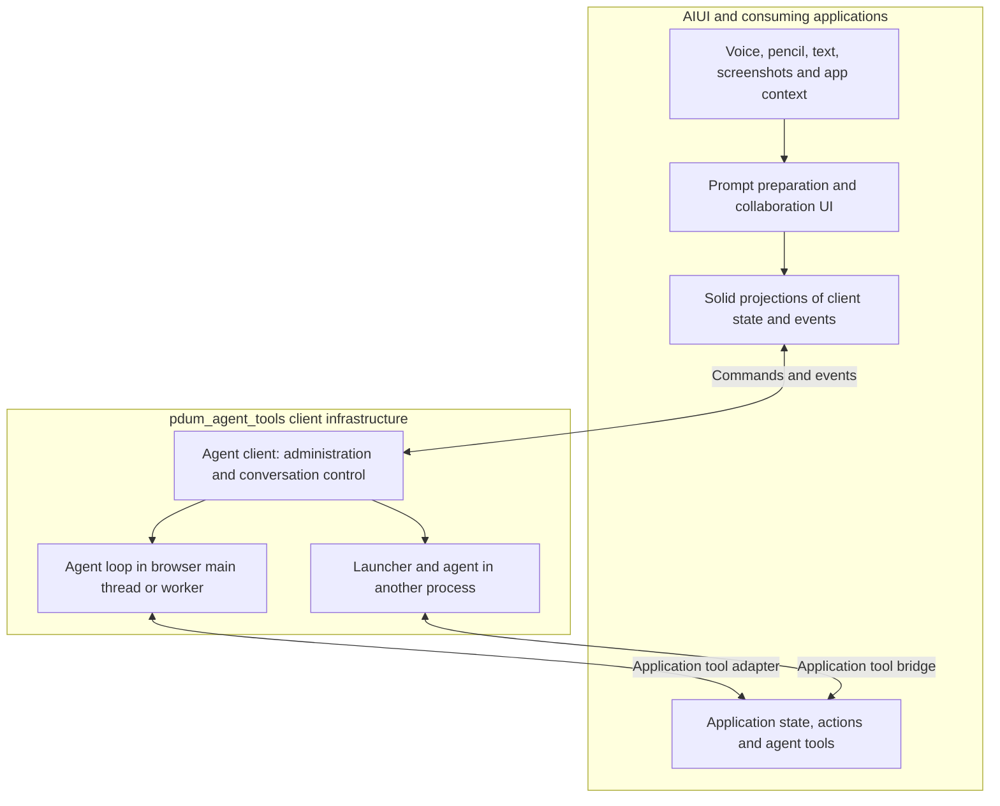

# Agentic patterns and use cases

Status: proposed direction, 2026-10-14. This records the intended workflows and
library boundaries for the next generation of agent integration. It does not
fix a client API, package split, or implementation schedule.

AIUI should make working with agents efficient throughout application development
and scientific research. An agent may help build an application, operate it,
analyze its data, or help prepare a request for another agent. Voice and pencil
are core input modalities across those workflows, alongside text, screenshots,
and application context. Visible activity, traceable operations, and useful
usage accounting should accompany both prompt preparation and agent execution.

Every prompt AIUI submits through agentic tooling should pass through the shared
prompting toolkit as a structured prompt before being rendered for its destination.
This applies to human-composed requests and prompts assembled by higher-level
systems. The structure may be coarse or detailed; it gives the user an inspectable
record of the content and how it became the input sent to the agent.

Separate **the agent and its client infrastructure** from **the prompting and
collaboration interface**. The former runs and controls agents; the latter helps
people express intent, supply context, steer ongoing work, and inspect results.
The same interface components should work with agents running in a browser or
in another process, and the same agent client should support several interfaces.
Concrete combinations may need specialized adapters without collapsing these
two responsibilities into one copilot implementation.

This continues the [application patterns](../application-patterns/README.md) and
the [Pencil architecture](../../packages/aiui-pencil/docs/architecture.md).
The application patterns describe where an application runs and how it is
delivered. This proposal describes how a person collaborates with agents within
and across those arrangements.

## 1. Independent choices that compose

An agent experience has several independent dimensions:

| Dimension | Intended choices |
| --- | --- |
| Purpose | Build an application; use an application or analyze data; prepare or refine a prompt. |
| Interface placement | Embedded web UI; standalone prompting website; companion page; Chrome extension; portable Electron app; desktop-specific floating utility. |
| Agent execution | Browser main thread; browser worker; local process; remote process. |
| Input | Typed or dictated text; live voice; pencil strokes; screenshots and images; selected content and structured application state. |
| Prompting style | Detailed dictation and multimodal drafting; conversational live voice with delegation; interleaving both while steering the same agent. |
| Visibility | Compact proof of life; an ongoing transcript workspace; forensics across operations and sessions. |
| Conversation state | Client-maintained history; agent-runtime history; provider-maintained conversation state; combinations with explicit ownership. |
| Persistence | Browser-local storage; remote application storage; storage supplied by the agent runtime or provider. |

These choices should not force each other. An Electron prompt panel can drive a
remote Codex session. A static scientific website can run its agent loop in a
worker while calling a hosted model. A companion page can prepare a prompt for
an agent operating a different browser. Browser execution describes the location
of the orchestration and tool loop; it does not imply local model inference.

The five existing application patterns remain useful: self-contained browser
computation, browser applications using SaaS, browser applications with custom
services, portable Electron applications, and desktop-specific Electron tools.
Agent integration composes with each. Adding a hosted model connection introduces
the SaaS concerns already described in those patterns; it need not introduce a
custom application backend.

## 2. Responsibility across repositories

[`pdum_agent_tools`](https://github.com/habemus-papadum/pdum_agent_tools) is the
intended home for agent launchers and the client SDK infrastructure used to
control agents. AIUI consumes that infrastructure and supplies the reactive
adapters, input components, and collaboration UI that applications assemble.

The diagram expresses intended responsibilities. It does not require one common
wire protocol or a new server between every client and agent.

| Responsibility | Intended owner |
| --- | --- |
| Launch and discover agent processes, select profiles, manage process lifetime and connections | Agent-tools launchers and management infrastructure. |
| List and manage sessions, resume and fork, submit turns, steer active work, interpret provider events, manage context and compaction | Agent-tools client SDKs and their runtime/provider adapters. |
| Browser-hosted agent loop and its provider integration | Agent-tools infrastructure, consumed through a related client interface. |
| Reactive presentation of agent state; session browser; conversation, activity, usage and context views | AIUI adapters and reusable UI components. |
| Activity, tracing, and usage across agent work and input modalities | Agent clients and modality adapters supply operation and accounting facts; shared AIUI projections aggregate and present them; the host selects trace persistence. |
| Capture and edit multimodal input; compose structured prompt records; inspect their delivery to agents; AI-assisted prompt refinement | AIUI input components and the shared prompting toolkit, composed by an application; destination adapters render the records for the selected agent client. |
| Domain meaning, application operations, data analysis, and validation of edits | The consuming application, exposed through AIUI's existing tool surface. |
| Desktop windows and hotkeys, extension integration, companion pairing, application storage configuration | The host application and environment adapters, with reusable helpers where useful. |

The client used by these interfaces runs in the browser, including an Electron
renderer. It abstracts whether the agent loop is local to that browser or
reached through a connection to another process.

The client SDK may have several flavors. A Codex app-server client, an official
Claude SDK integration, and a browser agent need related concepts without
pretending their capabilities and lifetimes are identical. AIUI should consume
capabilities and observable state rather than embed vendor protocol details in
its widgets. Provider-specific controls can extend a shared UI when needed.

The current agent-tools code establishes part of this boundary. Its Codex relay
forwards protocol messages without becoming a conversation SDK. The Claude
launcher separates process/history management from conversations owned by the
official browser or Node SDK. Its small
[browser example](https://github.com/habemus-papadum/pdum_agent_tools/tree/main/examples/claude-client)
already offers history, new conversations, resume, fork, and streamed chat. That
example is useful evidence for the separation; it is not the settled reference
client or the complete multimodal interface envisioned here.

## 3. What the agent client needs to make available

### Administration and session data

The administration layer should let a UI discover available agents or launch
targets, start an agent when needed, list past sessions, inspect their history,
create conversations, resume work, fork a conversation, and manage session data.
An application might expose a full session manager or only a destination picker.
Neither should require every widget to know how a process is launched.

Distinguish the agent runtime, a persistent conversation, an active turn, and the
client's current connection. A process or connection is not necessarily the
conversation's lifetime. Closing a panel should not implicitly choose whether to
end the agent, close a transport, or discard history. The client adapter defines
those operations and reports the runtime's actual behavior.

Selecting a destination should identify the relevant agent, conversation, and
working context. This matters when a prompt utility can reach a fleet of agents,
several research sessions, or multiple checkouts and browsers. Forking a
conversation also does not by itself fork application data, a repository, or a
running browser; those are separate application or environment operations.

### Conversation and turn control

The interaction layer should support starting a turn with multimodal information,
streaming responses and activity, supplying further information during a turn,
answering agent questions, interrupting work, and continuing the conversation.
Mid-turn steering is a primary workflow, not an eventual enhancement to a
send-and-wait chat box.

Steering must retain its actual meaning for the selected agent. Adding input to
the active turn, queuing input for a later turn, and interrupting before starting
again are different operations. A UI should show which occurred and whether the
input was accepted, is pending, or failed. It should preserve the draft when
delivery fails. The common interface should expose differences in supported
modalities and steering behavior instead of silently treating them as equivalent.

### Context and conversation continuity

The client is aware of low-level conversation details: available context size,
reported usage, compaction, and the state needed to continue or fork. It should
expose those details so AIUI can provide useful context meters, history views,
compaction controls, and progress feedback. Provider accounting and compaction
mechanics belong in agent-tools; a UI can request an operation and display its
outcome without implementing those mechanics again.

Exact measurements, estimates, and unavailable information should remain
distinguishable. An unknown context limit should not look like an empty context
window. The UI also needs to distinguish the history a person can inspect from
the context currently supplied to the model, particularly after compaction.

These are requirements for the client boundary to develop jointly with
agent-tools, rather than claims that every existing backend already supports
them.

## 4. Core workflows

### Build and modify an application

A person uses the running application while a development agent changes its
source. They can describe an improvement, circle a plot or control, attach a
screenshot, dictate a correction, and send the resulting context to the agent.
They can steer the same work as the application updates.

AIUI already exposes controls, actions, cells, source locations, page content,
and selections through its agent tool surface. The prompting interface should
make that context easy to include. The development agent can inspect the running
application, edit source, and observe the result. The existing durable/disposable
architecture preserves live state across supported hot updates; the interface
should cooperate with those boundaries.

[`aibr`](../../packages/aibr/README.md) supplies a complementary part of this
workflow: selecting or launching a browser and connecting Claude Code or Codex
to it through browser MCP. It makes the intended browser environment available
to an agent. The agent client supplies conversation control; the prompting UI
supplies human interaction. How a future launcher composes these pieces is still
to be designed, rather than assuming that a client connection selects the right
browser automatically.

### Use an application and conduct research

An agent helps explore a dataset, adjust parameters, run an analysis, compare
results, explain a scientific figure, or work on a circuit design. Its tools
operate on the same application state and validated operations as the human UI.

For example, a person circles a circuit element and says, "Compare this with the
other configuration." The application can supply ink, speech, the visible
diagram, and its symbolic circuit model. The agent can ask for clarification,
run the comparison, change the view, or explain a result. Ink alone need not
determine whether the person intended selection, annotation, or editing.

An application can offer both research assistance and development assistance.
The destination and working context should make it clear whether a request is
going to an agent operating the domain tools or one working on the implementation.
This distinction need not require a universal mode selector for every utterance.

### Prepare, refine, and deliver a prompt

A generic prompting utility collects text, dictation, screenshots, pencil marks,
and other context into an editable draft. The person can clean it up manually or
enter an AI-assisted edit experience: correct transcription, improve clarity,
reorganize instructions, or refine how attachments relate to the request. The
result is then sent directly to a chosen agent or conversation.

The editing helper and the destination agent are separate roles. They may use
different models, sessions, or runtimes. An instruction to the helper such as
"make the second paragraph clearer" acts on the draft; it should not accidentally
become a command to the destination agent. Editing a prompt need not submit it.
The same components should support preparing the first turn and refining a
follow-up while another turn is in progress.

A useful interaction sequence is:

1. Capture speech, text, ink, and relevant visual or structured context.
2. Review and revise the draft, optionally with the editing helper.
3. Select or retain the destination conversation and the intended delivery action.
4. Render the structured prompt for the destination, submit it, and observe delivery and agent activity.
5. Add context or steer the work, then revisit or fork the conversation later.

This is an interaction recipe, not a mandatory sequence of screens. A quick
dictation can go directly to submission; a difficult scientific request can stay
in preparation for several revisions. Direct delivery to known agents is a core
benefit: the usual workflow should not require a clipboard round trip.

### Structured prompts before delivery

Use [`aiui-prompts`](../../packages/aiui-prompts/README.md) as the common
intermediate representation for prompt content. Rich prompt preparation should
compose dictated text, screenshots, pencil captures, and application context
through this toolkit. A simple unstructured dictation can remain one exact text
block inside a structured prompt record. The person need not organize it into
sections or have an agent infer a schema before sending it.

Higher-level systems should use the same path when assembling instructions,
task descriptions, selected data, tool briefs, or delegations. They can retain
finer structure, reusable sections, and recorded choices where useful. Whether
the request comes from a person, an application workflow, a prompt-editing helper,
or a live voice delegation, its prompt content should have this intermediate
stage. This includes follow-up and mid-turn steering prompts.

The shared flow is composition into a semantic prompt record, binding that
content to an operation, and rendering it into the items or payload expected by
the selected client. Different agents may need text, ordered multimodal items,
or another supported format. Destination adapters handle that final conversion;
the structured record remains available for inspection. Prompt content and the
operation that delivers it stay distinct: the same content might start a turn,
steer an active turn, or be delegated to another agent.

Showing what was actually sent is part of the collaboration experience. Reuse
[`aiui-prompts-inspector`](../../packages/aiui-prompts-inspector/README.md) to
connect the prompt's composition and assets with its rendered output. A user
should be able to inspect a submission from the transcript or trace, understand
which user material and system-provided context it included, and see recorded
selection or rendering decisions. Coarse input warrants coarse inspection; rich
composition should preserve the detail needed to explain its output.

Retain the submitted semantic record and operation, associate them with the
transport's captured payload and delivery status, and keep later draft edits
separate. The toolkit already distinguishes prepared delivery from captured wire
data. A preview describes what is prepared; evidence from the sending boundary
establishes what was sent. Neither alone establishes what a remote runtime added
to the model's effective context. The host still owns sending and asset storage,
and the client reports acceptance or failure. This adopts the existing toolkit's
record and delivery model rather than introducing a parallel prompt format in
the agent UI.

## 5. Interfaces built from shared components

| Interface | Intended experience | Environment-specific needs |
| --- | --- | --- |
| Standalone prompting website | Compose, refine, and route multimodal prompts to selected agents; browse conversations. | Connections to agent services and a chosen persistence strategy. |
| Small Electron prompt utility | A low-chrome floating panel with the quick invocation and dictation flow of Wispr Flow, extended to screenshots, pencil, and direct agent delivery. | Desktop activation, window behavior, capture, and access to configured agent launchers. |
| Prompting and collaboration inside a scientific app | Work beside a circuit, plot, notebook, or analysis; include domain context; enter prompt editing when useful. | App tools, selection, symbolic data, and domain result presentation. |
| Chrome extension over arbitrary websites | Prepare prompts with context from the current page, even when the site does not embed AIUI. | Extension capture and page integration; available context depends on the host site and extension capabilities. |
| Companion website or device | Provide a separate prompting surface, perhaps with tablet pencil and voice, while the main application stays elsewhere. | Pairing, context exchange, and feedback from the authoritative host. |

These are candidate applications and demonstrations. Some may live in this
repository initially; others may be separate products consuming its libraries.
Supporting a pattern can mean a component, adapter, small helper, or example.
It does not require turning every environment into a new framework package.

The reusable center is draft composition and editing, multimodal input review,
destination selection, conversation and activity views, and steering controls.
Window chrome, extension integration, and companion transport remain host-specific.
The existing companion direction uses an authoritative host browser, with input
and applied-state feedback exchanged with the companion; this proposal does not
assign a second owner to that state.

The [WebRTC and companion proposal](./webrtc-and-companion-pages.md) develops the
pairing and local communication model. One companion belongs to one running
main-page instance, where domain features and shared prompt tools can use the
same pairing. Surface provisioning and edit semantics will be established through
the mathematical utility and circuit designer applications.

## 6. Pencil and voice as core input

Voice supports several related experiences: dictation into a draft, a live
conversation with an agent, spoken correction of a draft, and steering ongoing
work. These experiences should reuse audio capture and routing while retaining
their different destinations. Switching from dictation to the editing helper
should preserve the draft and make the active audio destination apparent.

### Dictation and editing with diff feedback

For detailed requests, use ElevenLabs speech-to-text to build an editable draft,
with screenshots, pencil, and other context added as needed. Every dictation
surface should use the shared diff-flash presentation so revisions to recognized
text are visible as they happen. The existing
[`LiveDiffText`](../../packages/aiui-viz/src/live-text/flash.ts) supplies this behavior:
new words appear immediately, while rewrites briefly show the word diff before
settling to the current text.

Agent edits to the dictated text should use the same diff-flash language. A
transcription correction and an editing helper's revision both make the changed
words apparent, while activity metadata identifies who made the change. Keep
this immediate visual feedback in the draft itself; the person should not need
to open a trace viewer to notice that their text was revised.

### Live voice delegation and interleaved prompting

For casual requests and quick exchanges, offer an OpenAI GPT-Live voice front
end in client delegation mode. The person talks with the voice model and gets
spoken feedback; the integration hands delegated work to the selected underlying
agent through its client. That agent may be in the browser or a remote process.
The existing [two-model voice loop](../../packages/internal/aiui-live/docs/live-primer.md)
provides a starting point for this arrangement.

Detailed dictation and live conversation are complementary prompting styles.
A person might compose a careful request with images, send it, then switch to
live voice for a quick correction or question while the agent works. They might
also interrupt a casual exchange to dictate a precise specification. Both
styles should be able to address the same destination conversation and ongoing
work. Switching styles should preserve the draft, attachments, and agent state.

Only one destination receives microphone input at a time. Reuse the existing
audio hub's routing to choose dictation, the editing helper, or the live voice
front end. Capture ownership remains with the hub; the UI shows which system is
currently interpreting speech and producing prompt material. Changing that route
does not itself submit a draft, end the underlying agent's turn, or discard the
other interface's state. Input routing and spoken-output selection are separate
controls, as they are in the audio hub.

Steering belongs in both interfaces and in the transcript workspace. A typed or
dictated correction can go directly through the agent client; a spoken correction
can be handed off by the live front end. The integration must route it to the
intended active turn and surface the client's delivery status. Instructions to
the voice model affect its behavior; steering the underlying agent requires its
own client operation. A spoken acknowledgement alone does not establish that the
working agent received the correction.

### Pencil and multimodal context

Pencil supports handwriting, mathematics, diagrams, annotations, and spatial
references to existing content. Follow the Pencil architecture's separation between
editable ink, immutable captures, and application interpretation. An agent can
interpret speech, ink, and context together without a required classification
step for selection, authoring, annotation, or correction.

An optional prompt-editing mode is compatible with that principle: it changes
which draft or conversation receives input, rather than requiring the person to
classify the meaning of every mark. The application may offer narrower tools or
modes when they help a particular task.

Multimodal composition needs to retain the relationships among its inputs. A
spoken "this" may refer to a circled region of a screenshot or a selected circuit
element. Drafts and submitted records should be able to associate text, audio or
transcripts, ink captures, images, and structured context. Capture timing,
coordinates, and relevant content revisions should travel with them where needed.
The image and ink submitted for one turn should remain stable while the person
continues drawing or the application changes.

### Existing foundations

AIUI already has useful building blocks:

- [`aiui-audio`](../../packages/aiui-audio/README.md) for shared capture, routing,
  and playback, and [`aiui-stt`](../../packages/aiui-stt/README.md) for dictation.
- [`aiui-pencil`](../../packages/aiui-pencil/README.md) for local ink input,
  with the proposed data, editing, and capture boundaries.
- [`aiui-screen-capture`](../../packages/aiui-screen-capture/README.md) for
  browser capture sessions and previews.
- [`aiui-prompts`](../../packages/aiui-prompts/README.md) for semantic prompt
  records, composition, inspection, and delivery preparation.

These are foundations, not a claim that the complete multimodal prompt editor
already exists. Prompt records also do not replace conversation history or media
storage; captured assets need a lifetime that matches their references.

## 7. Visibility, tracing, and usage

Visibility should cover the whole interaction: a long-running agent task,
speech-to-text while dictating, an agent editing a draft, live voice delegation,
and application tool execution. Each should expose enough activity to understand
what is happening, notice something unexpected, and intervene. The exact visual
design remains open; these are the levels of detail the components should support.

### Three levels of detail

| Level | Purpose | Intended presentation |
| --- | --- | --- |
| Proof of life and signaling | See that work is happening and get a quick sense of whether it looks right. | Compact icons or Unicode symbols, short text snippets, and subtle changes indicating events such as a tool call, transcript revision, delegation, or completed step. |
| Transcript | Follow the work in detail and steer it as it happens. | A CLI-like stream comparable to Claude Code or Codex: messages, progress, tool activity, results, and relevant usage, with controls for follow-up input and interruption. |
| Forensics | Investigate individual operations and patterns across sessions. | Search retained activity, inspect individual traces, calculate costs, and compare usage, timing, errors, and other statistics across sessions and modalities. |

Proof of life should be grounded in observed events. A snippet such as "reading
the circuit" or "updated the second paragraph," together with an activity cue,
is more informative than an undifferentiated busy indicator. Waiting, receiving
input, executing a tool, and a reported failure should be distinguishable at a
glance. A connection indicator can show that a session is alive even when there
is no new progress event; it should not invent progress.

The transcript is a working surface that a person may keep open throughout a
session. Layouts need to accommodate that use, for example with a persistent or
resizable pane beside the application or draft. It should also be convenient to
open temporarily from a compact activity cue. The person can inspect a tool
result and immediately steer the associated work without changing conversations.

Forensics can be a separate view or application using the same retained records.
It should support moving from a session total or statistical outlier into the
operations that explain it. These levels are complementary views of related
events: a compact indicator, an open transcript, and later trace analysis should
agree about what happened. Opening a detailed view must not be what starts
recording the activity needed to populate it.

### Cost and usage across the whole session

Surface cost, token counts, and other useful usage measures both for individual
operations and for the entire working session. That session may include several
provider sessions and services: ElevenLabs dictation, the prompt-editing agent,
the destination agent, GPT-Live conversation, multimodal model inputs, and explicit
text-to-speech output. An application-level association should let their records
contribute to one total while retaining breakdowns by operation, agent, service,
and modality. Switching prompting styles must not reset the total.

Show compact usage summaries where people work, with detail available in the
transcript and forensics views. Preserve provider-reported units: token categories
where available, audio duration or other service units where appropriate, and
cost with its currency and basis. Different services need not report tokens or
charge in the same units. Reported amounts, calculated estimates, and unavailable
usage should remain distinguishable; missing usage must not silently become zero.

Aggregation needs to respect how a source reports usage. Incremental operations
and cumulative session counters cannot both be added as new charges. Associate
records with their actual operations so relayed events, reconnects, history
replay, and shared history in forks do not count the same work twice. Detailed
accounting rules belong with the relevant adapters and shared accounting logic;
individual widgets should consume consistent projections.

### Visible feedback when agents use application tools

Every agent invocation through the application's tool surface should produce a
subtle visible indication, including reads and captures that leave no persistent
change on the page. This belongs at the framework's shared tool invocation
boundary, so local agents, delegated agents, and remote agents receive consistent
feedback without each application hand-writing it for every tool.

When a tool has a visible target, the cue can be attached to that element or
region: a brief highlight, a click-like marker, or a capture flash. A tool without
a visible target can signal through the compact activity area. The precise
symbols, placement, and animation need design work; the requirement is that the
user can perceive what the agent is doing while continuing to use the website.
Calls should be traceable through start and outcome, including failures, with a
route from the subtle cue to transcript detail. High activity should remain
readable without losing individual calls from the underlying record.

The existing tool registry and call log are a starting point. Consistent spatial
annotations and coverage across the intended agent adapters are proposed
framework work. Browser actions reported by an external browser adapter can join
the same activity view; the page's own tool registry alone cannot observe them.

## 8. Browser and remote execution

A browser-hosted agent can run on the main thread or in a worker. Main-thread
orchestration may be sufficient when most work is network I/O. A worker is an
option for separating the agent's execution and messaging from the UI; it should
not be mandatory solely because the software is an agent.

One intended implementation is an OpenAI Agents SDK-based loop around steerable
GPT-6 models, with model connections such as WebSockets where supported. Other
models and SDKs should fit the same broad client responsibilities. The aim is
conversation and turn control broadly comparable to driving Codex through
app-server. This is an implementation direction to qualify in agent-tools;
concrete SDK and model capabilities determine each adapter's supported behavior.

A remote agent may be Codex or Claude Code on the same machine as the browser or
on another host. Agent-tools handles launching and reaching it. AIUI consumes the
client interface without needing to care which machine performs the agent loop.
It still needs observable differences such as connection loss, launch progress,
and whether work continues when the UI disconnects.

Application tools need an explicit connection in every placement. A browser agent
can use local tools; a worker needs a bridge to main-thread application state;
an external agent needs a reachable browser/tool bridge. All should invoke the
existing application operations and validation. Sharing a client API alone does
not make arbitrary page tools available to a remote agent.

### Tool relay and spoken updates

In a delegated voice workflow, the underlying working agent should be able to
discover and call the relevant application tools through an adapter or relay.
Carry the tool descriptions and application brief as well as calls and results,
so the agent can understand the surface it is driving. Route calls through the
same instrumented application boundary used by other clients, retaining their
relationship to the originating session, turn, and delegation.

An agent should also be able to notify the person while work continues. Support
two useful paths:

- **Live-model commentary.** Forward progress or results through the GPT-Live
  commentary mechanism. The voice model decides how to express that information
  in the ongoing conversation. Keep the agent's update and any available spoken
  transcript associated so the user can inspect both.
- **Explicit text-to-speech.** Expose an optional speech command or tool that the
  agent knows how to use for occasional updates when the person wants them. The
  agent supplies the text to speak; this path can operate without an active live
  conversational model.

Spoken updates, transcript entries, and compact visual signals are separate
presentation choices over related activity. Let the person choose when spoken
notifications are wanted, coordinate output through the audio facilities, and
avoid speaking the same update through both paths accidentally. Sending commentary
to the voice model does not replace delivery of a steering instruction to the
underlying agent. Include voice and speech-generation usage in session accounting.

## 9. History, storage, and forking

Two decisions must stay separate: who maintains the state used to continue a
conversation, and where the application persists its own records.

| Conversation strategy | UI and integration implications |
| --- | --- |
| Maintain full message history ourselves | The client/runtime supplies the required history on continuation and implements the supported branching behavior. The UI can present the retained record and the context selected from it. |
| Rely on an agent runtime's saved sessions | The client uses that runtime's history, resume, and fork operations. The UI presents their actual semantics and relates them to local drafts and captures. |
| Rely on provider-side conversation state | The client retains provider identifiers and uses supported continuation or fork operations. The UI cannot assume that an identifier is a locally readable transcript or that every provider supports the same fork operation. |

Simple sites may use browser-local persistence, including local storage for small
records. Richer applications may use a browser database or remote storage for
sessions, drafts, and media. A remote agent may already persist its own history.
The interface should work with those choices instead of requiring one AIUI
database service.

Each integration needs a clear authority for continuation and a way to relate
the UI's records to it. Distinguish the working draft, the submitted prompt and
its assets, the visible conversation/activity history, and the model's effective
context. A local view of a remotely maintained conversation may be a projection
or cache; it should not silently become a competing source of truth.

For research, revisiting a session should make it possible to inspect the input
and results that were retained, including the structured prompt records and their
associated operations and captured deliveries. Forking should preserve the chosen conversation
lineage and the references needed to understand it. Capturing or restoring the
underlying experiment, dataset, or application state is an additional domain
capability, not an automatic consequence of a conversation fork.

Trace and usage records need a retention strategy alongside conversation history.
Forensics across sessions depends on retaining operation identities, timing,
relationships, outcomes, and accounting facts beyond the live UI's lifetime.
The host can choose local or remote storage and the level of payload detail to
retain; a provider conversation identifier alone does not supply this record.

## 10. Event streams and Solid integration

The UI will reduce agent event streams into observable state. The SDK owns
protocol interpretation and conversation correctness; AIUI provides reactive
projections suited to SolidJS, without independently reconstructing conflicting
session state in each component.

Useful projections include available sessions, the selected conversation, active
turns, streamed content, tool activity, delivery acknowledgements, questions,
connection state, usage, and compaction progress. Include dictation revisions,
agent draft edits, voice delegations, and spoken notifications in the shared
activity model. Adapters should preserve the identities and timing needed to
connect an update to its working session, provider session, turn, input, tool
call, or delegation. Proof-of-life, transcript, forensics, and accounting views
should derive from these related facts rather than maintain separate histories.
Where the SDK supplies snapshots or replay, AIUI should use them to initialize
and recover its projection. Rebuilding a view must not resend a prompt or re-run
a tool.

Follow the [frontend playbook](../../packages/aiui-viz/docs/frontend-playbook.md):
pure draft/reducer logic, then reactive state and cells, then components, then
application composition. Durable owners hold clients, drafts, and resource
lifetimes. Disposable graphs and components derive and display their state.
Streaming derived values can use cells; explicit commands control agent turns.
A reactive recomputation should not accidentally launch another turn.

Microphone samples, live ink, and network events need not each become a cell.
Capture and transport resources can retain their imperative loops and publish
appropriate observations. Preserve meaningful events while bounding visual
update frequency. UI remounts, supported hot updates, and navigation should not
duplicate subscriptions or destroy a conversation merely because its panel is
temporarily absent.

## 11. Replacing Oracle and Live

[`Oracle`](../../packages/internal/aiui-oracle/README.md) and
[`Live`](../../packages/internal/aiui-live/README.md) are the existing first-generation
copilot implementations. They already contain useful engine/widget separation,
event ledgers, tool integration, voice controls, and—in Live—delegation machinery.
The [dock](../../packages/internal/aiui-dock/README.md) embeds both in applications.

The next generation should replace those separate stacks with a more deliberate
agent-client boundary and shared collaboration components. Preserve useful
behavior and lessons without requiring new interfaces to inherit Oracle's or
Live's full session model. Live voice remains one important experience within
the broader system; prompt preparation and long-running research conversations
also need first-class support.

The replacement should preserve live voice as a delegation front end that can
coexist with dictation, prompt editing, and direct agent steering. Shared activity
and accounting should span all of them. Migration details remain open: which
runtime pieces move to agent-tools, which become adapters, the concrete delegation
and notification contracts, and when the old packages can retire. A replacement
should be demonstrated in actual workflows before the existing experiences are
removed.

## 12. Reference scenarios and next design questions

Use concrete scenarios to decide which abstractions are worth extracting:

| Scenario | What it should establish |
| --- | --- |
| Dictate a prompt, attach an annotated screenshot, refine it with AI, and send it from a floating desktop panel | Shared multimodal draft and editing components; clear helper/destination roles; direct delivery to a selected agent. |
| Send a single dictated text block, then a rich prompt assembled by an application workflow, and inspect both submissions | The shared prompting toolkit handles coarse and fine structure; inspection connects semantic records, selected content, rendered payloads, and delivery evidence. |
| Circle a circuit element, ask for an analysis, then steer the agent while it works | Pencil and voice composition; symbolic context; application tools; mid-turn input. |
| Ask a development agent to change a running visualization | Browser selection through `aibr`, application/source context, live feedback, and cooperation with HMR. |
| Run the same embedded collaboration UI with a browser agent and a remote agent | A useful shared client boundary with explicit capability and lifetime differences. |
| Leave, reopen, inspect, and fork a research conversation | Session administration, persistence, retained media, context visibility, and honest fork semantics. |
| Prepare a prompt in an extension or companion page | Reuse outside the target application's UI, with context and transport supplied by the host environment. |
| Dictate through ElevenLabs, then ask an agent to revise the draft | Shared diff-flash feedback for STT revisions and agent edits, identifiable activity sources, and operation/session usage. |
| Send a detailed prompt, switch to casual live voice, then dictate a precise mid-turn correction | One selected microphone destination, preserved draft and agent state, and observable delivery of steering to the working agent. |
| Watch an agent call page tools while following a persistent transcript | Subtle per-call visual cues, useful compact progress, adequate transcript space, and steering from the same workspace. |
| Inspect a session's total cost, compare it with other sessions, and open an expensive trace | Accounting across all modalities, consistent operation identity, and retained detail for forensics. |
| Receive occasional spoken progress while an agent uses relayed application tools | Underlying-agent tool access, Live commentary or explicit TTS, coordinated playback, and traced notifications. |

The next planning work should settle the first reference workflow, the client
capabilities it needs from agent-tools, and the smallest reusable draft and
conversation components that serve it. Then decide the event/snapshot boundary,
media and trace retention contract, worker/tool bridge, and concrete routing
between the voice front end and the agent it controls. Design the compact signals,
persistent transcript layout, tool annotations, and usage summaries together so
their levels of detail connect naturally. Concrete SDK names, a universal session
schema, a mandatory persistence backend, and the final package layout can wait
until those examples establish the requirements.
