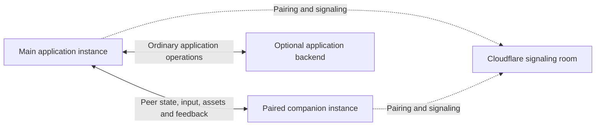

# WebRTC and companion pages for rich input

Status: proposed direction, 2026-10-14. This records the intended workflows and
responsibilities. Concrete applications will establish the companion interfaces,
edit semantics, and reusable APIs.

AIUI should support a companion interface paired with one running application
instance in a browser tab or window. The companion supplies a convenient surface
for handwriting, diagrams, and image annotation while the main application stays
on another display. Both peers compute and render locally, exchanging the state,
input, and assets needed for their work.

The initial setting is a Mac with a large primary monitor and a Wacom pen display
connected as another monitor. The same pattern should extend to an iPad running
its own browser. A static website can support a companion; an application's
backend needs no companion-specific behavior or awareness.

This develops the companion direction in the
[application patterns](../application-patterns/README.md) and the shared input
workflows in [agentic patterns and use cases](./agentic-patterns-and-use-cases.md).
It also establishes a reusable WebRTC layer for other peer arrangements,
including a browser exchanging media and data with Python or C++.

## Three responsibilities

| Part | Responsibility |
| --- | --- |
| Rendezvous and signaling service | Introduce the intended peers and exchange connection information. The proposed hosted implementation uses Cloudflare Durable Objects with hibernating WebSockets. |
| AIUI WebRTC support | Connection flows, data channels, media streams, Solid reactive observations, and diagnostic components. Support browser peers and peers implemented in other languages. |
| Companion support | Open or connect a secondary interface, route work from features in the main instance, exchange context and results, and compose pencil-friendly views. |

WebRTC support should be a separate package from companion support. It should be
usable without a companion, a prompt editor, or a particular signaling provider.
Companion support may include integration in `aiui-viz`; its final placement and
public surface remain open. Existing input and prompt packages supply reusable
parts without taking ownership of pairing.

The signaling service is also independent. A peer connection needs a way to
exchange connection information, but that need does not require every deployment
to use the hosted Cloudflare service.

## Pairing belongs to a running instance

The pairing unit is a particular main-page instance and its companion. An
account, login session, browser profile, or site origin does not identify that
instance. Two tabs of the same application must be able to have independent
pairings. A companion must not receive another tab's work merely because the tabs
share an origin or user identity.

This association must survive the choice of transport. WebRTC naturally connects
specific peers; a browser messaging bridge must preserve an equally explicit
association. Any shared discovery channel or messaging bus needs to distinguish
the participating instances and route work only to the intended peer. Pairing,
reload, reconnection, and replacement of a closed peer need deliberate lifetime
rules, to be established through the applications.

The initial state model retains one authoritative host: the main application
instance. The companion sends input, commands, or state deltas. The host applies
the relevant application rules and returns resulting state and feedback. Local
pen rendering should remain responsive while that exchange happens. A transport
acknowledgement and acceptance of an application edit are separate events.

The main application's backend remains outside this relationship. The host may
continue its ordinary backend operations, including saving application edits,
without adding a companion identity, connection registry, or companion-specific
API there. The rendezvous service only assists connection setup and maintenance.
Application state, screenshots, and ink flow between the paired instances.

The diagram shows the hosted signaling option. A same-browser connection can
establish communication locally without visiting that room.

## Companion workflows

A person starts with the main application and opens the companion when pencil
input becomes useful. On the Mac, the companion runs in another window on the
Wacom display. A second window on one display is also possible; the essential
property is a useful pen-input surface alongside the main working view.

One prompt-preparation workflow is:

1. Compose a request in the main application or its prompt editor.
2. Capture a region of the page and add the image to the draft.
3. Select that attachment and open it on the companion.
4. Mark it up with the pen.
5. Incorporate the annotated material into the same draft.

A draft may contain several screenshots. Each should remain identifiable so the
person can select one, annotate it, revisit it, and return the result to the
correct place. Capturing and annotating an image can also precede adding it to a
draft. This is a workflow to support, not a mandatory sequence of screens or a
universal rule for when edits become accepted.

A domain application can supply a different companion view. A mathematics tool
may show organized text or LaTeX on the main display while the person writes and
talks on the companion. A circuit designer may share circuit state while offering
a drawing or annotation view suited to the pen display. Another application may
simply present a second viewport of the same information.

For a website, the baseline is an easy way to open the companion and move its
window to the pen display. Supporting browsers can improve placement through the
permission-gated [Window Management API](https://developer.chrome.com/docs/capabilities/web-apis/window-management).
An Electron host can use its [display APIs](https://www.electronjs.org/docs/latest/api/screen/)
and [window controls](https://www.electronjs.org/docs/latest/api/browser-window/)
to select a display, remember a preference, and offer full-screen placement.
Placement conveniences belong to the environment adapter; the input workflow
should also work with manual window placement.

## Shared views and multiple callers

The companion renders using its own application logic and shared UI components.
Peers exchange serializable state, operations, ink, and assets. They do not share
a live Solid graph or DOM. Continuous video mirroring of the main page is outside
this companion pattern. Screenshots are discrete image assets that can be marked
up and returned; the general WebRTC package can independently support video.

The application should preserve the relationships needed to interpret a mark:
which image or domain object it refers to, the relevant content revision, and
its coordinate system. The [Pencil architecture](../../packages/aiui-pencil/docs/architecture.md)
already separates editable ink, immutable captures, and application interpretation.
Keeping the original image and editable ink available allows an annotation to be
revisited even when a composed image is also produced for a prompt.

Several features within the main instance may use the same companion. The domain
application may have a companion view while a shared prompt tool requests image
annotation. These features should reuse the instance's pairing rather than each
establish an unrelated connection. Work needs enough identity to retain its
owner, context, and return destination when the person changes activities.

How those activities coexist remains open. Possibilities include switching views,
temporarily opening a tool, or retaining several workspaces. A new request should
not silently overwrite unfinished input or send a result to a different draft.
The concrete applications will establish the useful interaction and lifetime
rules; a universal task queue or workspace manager is not yet specified.

Companion-page provisioning also remains open. There is no requirement that each
application ship its own dedicated companion page. Shared side tools, including
prompting tools, may supply or allocate companion surfaces automatically, with
enablement chosen case by case. How those surfaces acquire domain-specific views
and share components is part of the application work. Supporting a companion
does not depend on first defining a new universal page abstraction in AIUI.

Acceptance of edits is application-specific. Explicit return, continuous applied
updates, AI interpretation, and review before incorporation may all be useful.
Transport and common input components should preserve context and delivery facts
without choosing those semantics for every application.

## Local communication and transport choices

Local computation and direct communication are the preferred arrangement. Here,
local computation means work performed on the participating devices: the Mac,
the iPad, or another peer. Same-machine communication, communication on one LAN,
and a direct internet connection are distinct cases.

WebRTC is the general path between browser peers, including two windows on the
same machine. It also permits moving the companion to another device without
changing the meaning of the application messages. A simpler browser messaging
bridge is worth considering for the same-browser case.

| Arrangement | Communication option |
| --- | --- |
| Main and companion in the same browser | WebRTC or a browser messaging bridge where the browser's isolation rules permit it. |
| Peers in different browsers, profiles, or devices | WebRTC, using an appropriate signaling path. |
| Windows managed by Electron | Browser messaging, an explicit desktop bridge, or WebRTC as appropriate. |
| Browser and Python or C++ process | WebRTC carrying the media and data required by that application. |

`BroadcastChannel` offers messaging between eligible contexts with the same
origin and storage partition. `MessageChannel` supplies dedicated ports when the
windows can establish a port exchange. Neither creates a cross-device transport,
and neither replaces explicit instance pairing. A service worker is not required
solely to communicate between windows. The choice among these mechanisms,
including whether a shared worker is useful, remains implementation work.
[HTML messaging standard](https://html.spec.whatwg.org/multipage/web-messaging.html)

The initial companion policy prefers direct WebRTC connections without TURN.
The motivation is performance and operational simplicity, rather than enforcing
a LAN-only security boundary. When direct connectivity fails, the companion can
report that failure rather than silently introduce a relay. TURN support remains
possible as an explicit policy. The general WebRTC layer, particularly its Python
and C++ use cases, must allow connection arrangements suited to those deployments.
[WebRTC connection model](https://webrtc.org/getting-started/peer-connections),
[TURN guidance](https://webrtc.org/getting-started/turn-server)

The communication path and signaling path are separate. Peers may use Cloudflare
over the internet to establish a connection whose application traffic stays on
one machine or LAN. STUN, where configured, assists connectivity discovery; TURN
relays traffic. Absence of TURN does not prove that a direct path stays on the LAN.

## Cloudflare rendezvous and signaling

The proposed hosted service uses one Durable Object as a small room identified by
an unguessable pairing token. The intended peers connect through WebSockets, learn
that the other peer is present, and exchange SDP offers, answers, and ICE
candidates. This is explicit rendezvous between peers, rather than automatic
enumeration of devices on a local network.

Use Cloudflare's WebSocket Hibernation API so peers can wait without continuously
running server code. Hibernation retains accepted WebSocket connections while
ordinary JavaScript memory can be discarded. Peer identity can be restored from
socket attachments; state that must survive disconnection needs separate storage.
Join and message handlers should finish instead of holding open an asynchronous
wait or recurring timer for the other peer.
[Cloudflare WebSocket guidance](https://developers.cloudflare.com/durable-objects/best-practices/websockets/),
[Durable Object lifecycle](https://developers.cloudflare.com/durable-objects/concepts/durable-object-lifecycle/)

Once connected, peers exchange application content directly. Signaling sockets
may remain available for renegotiation or be reopened when needed; closing them
does not itself close the established WebRTC connection. Room admission, token
expiry, reconnect behavior, and cleanup need concrete rules when the service is
implemented. They should preserve the intended instance pairing without making
the service an owner of application state.

Hibernation avoids idle duration charges when the object is eligible; connection
requests, signaling activity, and any retained storage still have their own
accounting. Cost estimates should use the deployed workload and current
[Cloudflare pricing](https://developers.cloudflare.com/durable-objects/platform/pricing/).
The service is not a media relay, and any TURN deployment has separate costs.

## WebRTC primitives and reactive integration

The WebRTC package should support establishing and disposing peer connections,
negotiation and recovery flows, data channels, and optional audio/video tracks.
Its signaling boundary should accommodate the Cloudflare room and other ways of
introducing peers. Browser-to-browser and browser-to-process connections should
share useful primitives without requiring identical peer capabilities.

Different traffic has different delivery needs. Completed edits and image assets
need dependable transfer; transient previews or rapidly superseded observations
may prefer freshness. Large screenshot transfers should not make pen feedback
unresponsive. Channel configuration, bounded queues, backpressure, and asset
transfer behavior belong among the transport concerns to evaluate. They do not
determine whether an application accepts or applies an edit.
[WebRTC data channels](https://www.rfc-editor.org/rfc/rfc8831.html)

Connection owners should retain resource lifetimes, while Solid adapters expose
coherent observations and reusable components display them. The existing
[frontend architecture](../../packages/aiui-viz/docs/frontend-playbook.md) provides
the durable-resource and disposable-view distinction. Rebuilding a graph or
remounting a status component should not establish another peer connection or
replay a command. High-frequency media and network processing need not publish
every event through a cell; observations can have a bounded UI update cadence.

## Connection visibility

The WebRTC support should make the actual connection inspectable through both
reactive values and ready-made UI. Useful observations include:

- Pairing, signaling, negotiation, connection, disconnection, and recovery state.
- The selected ICE candidate pair, transport protocol, relay use, and path changes.
- Round-trip time, throughput, outgoing queue size, and transfer progress.
- Media measurements such as sent, received, decoded, or presented frame rates,
  packet loss, jitter, and dropped frames, where available.
- Correlation capability and missing or late metadata when media association is in use.

Measurements must retain their meaning. Network round-trip time is different
from pen-to-display or inference latency. Video receipt, decoding, and presentation
rates describe different stages. An unsupported measurement is unavailable, not
zero. A data-only connection does not need an invented video frame rate, and a
local messaging bridge should identify itself as that transport.

WebRTC statistics expose the selected candidate pair and useful path evidence,
but addresses and other details may be unavailable or hidden. Show observed facts
separately from conclusions about locality. A direct connection with unknown
locality is a valid result; absence of a relay alone cannot justify a LAN label.
Signaling through Cloudflare and application traffic over a direct peer path
should also be distinguishable in the interface.
[WebRTC statistics specification](https://www.w3.org/TR/webrtc-stats/)

## Correlating data with media

A separate WebRTC requirement is associating data messages with particular video
frames or audio intervals. A Python peer might perform inference on incoming
video and return detections that the browser associates with the correct image.
Other applications may exchange sensor observations, audio analysis, or robot
commands alongside media. These uses do not require a companion page.

Media and data-channel arrival order does not establish correspondence. Frames
may be dropped, metadata may arrive late, and one video frame may span several
network packets. The application needs explicit media identity and timing rather
than assuming that the next data message describes the next displayed frame.

Browser APIs offer useful hooks. Encoded audio/video frame metadata exposes RTP
timestamps and stream identity, while video frame callbacks can expose the RTP
timestamp of a frame submitted for presentation. These are potential ingredients
for association, subject to the capabilities exposed by the selected browsers
and native peers. Arbitrary JavaScript properties attached to a frame do not
automatically become metadata delivered to the other peer.
[WebRTC Encoded Transform](https://www.w3.org/TR/webrtc-encoded-transform/),
[Video frame callbacks](https://wicg.github.io/video-rvfc/)

The intended capability should account for:

- A stream identity and media timestamp or interval, with application frame IDs
  mapped to that timeline where required.
- Stream replacement, restarts, and timestamp wraparound, so old metadata cannot
  be mistaken for a new frame.
- Bounded buffering and explicit handling of unmatched, missing, or late items.
- Distinct capture, processing, receipt, and presentation times, including the
  clock mapping needed to compare times originating on different peers.
- A distinction between exact frame association, approximate temporal alignment,
  and unavailable correlation.

For audio, associating an analysis with a captured interval is different from
identifying individual samples at playback. Codec processing, resampling, jitter
buffering, and loss concealment complicate the latter. Sample-level correlation
needs an explicit mapping through the relevant stages; it should not be promised
as a universal browser capability. Likewise, a native decoder's presentation
timestamps must be related to the browser's media timeline before matching them.

The wire representation and any embedded-metadata mechanism remain open. A small
browser-to-Python experiment should establish what can be correlated and measured
before fixing a general API. [aiortc](https://aiortc.readthedocs.io/en/latest/)
is one candidate for that experiment because it supports Python media processing
and data channels. A C++ implementation may be appropriate for different latency
or integration requirements; the browser-facing concepts should accommodate it.

## Concrete applications and open decisions

Two applications will drive the companion design:

| Application | Questions to establish through use |
| --- | --- |
| Mathematical utility combining speech and handwriting into LaTeX | How input and interpreted output move between displays; how shared prompting tools cooperate with a domain view; how revisions are reviewed or incorporated. |
| Circuit designer | How structured circuit state, pencil input, selection, and domain edits are represented across views; how companion activities coexist and preserve context. |

Both should exercise the Wacom workflow first, with the iPad arrangement informing
the peer boundary. They should establish surface provisioning, case-by-case
enablement, coordination among callers, reconnection behavior, and application
edit semantics. Shared helpers should follow those concrete needs rather than
require both applications to adopt a speculative companion framework.

Existing foundations include [Pencil](../../packages/aiui-pencil/README.md),
[screen capture](../../packages/aiui-screen-capture/README.md),
[audio](../../packages/aiui-audio/README.md),
[speech-to-text](../../packages/aiui-stt/README.md), and
[structured prompts](../../packages/aiui-prompts/README.md). They supply input and
composition primitives; the reusable pairing, transport, and companion workflow
described here remain work to develop.

The general WebRTC layer should also be exercised independently with a browser
and an inference or control process exchanging media and data. That scenario
will establish media-correlation capabilities and deployment-specific connection
policies without imposing its requirements on the pen-input companion.
