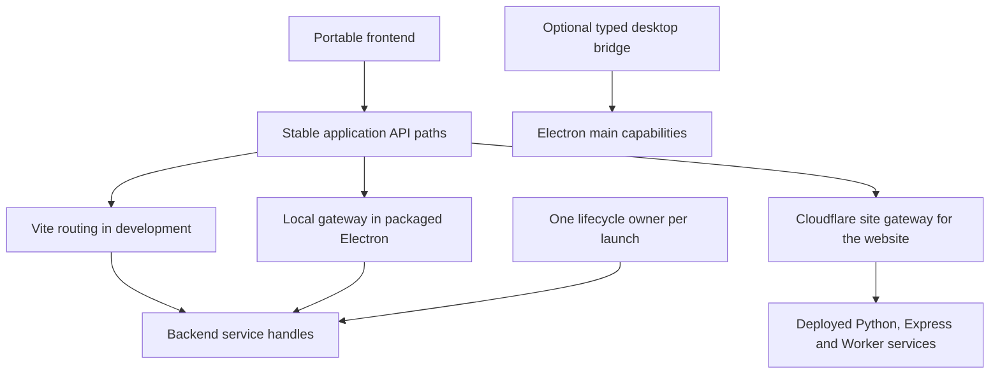

# DevStack and Electron Stack architecture review

Reviewed on 2026-10-13 on macOS arm64.

The signature findings below describe the unsigned artifact from that review.
The subsequent [macOS notarization spike](./macos-notarization/README.md) has
Developer ID signed the app and runtimes, obtained Apple's acceptance, and
validated the stapled DMG. Its cheat sheet covers reusable machine credentials.

**Both spikes establish a useful architecture to build on. The small lifecycle,
readiness, routing, and desktop-capability contracts are worth extracting. The
examples are not yet a complete production gateway or a validated Mac distribution
pipeline.** The review reproduced the reported development failure and found
additional gaps where the original tests bypassed the boundary they claimed to
exercise.

**The desktop 404s were a proxy configuration bug.** All three backends and the
private gateway returned 200 when called directly. Requests through Vite returned
404. The proxy target already contained the gateway's random path, and its rewrite
added the same path again:

```text
Frontend:         /api/python/info
Intended gateway: /<token>/api/python/info
Actual gateway:   /<token>/<token>/api/python/info
```

The shared [gateway proxy helper](./electron-stack/infrastructure/gateway-proxy.ts)
now supplies only the upstream origin as the target and adds the path once in
the rewrite. Electron development and browser-only development use that same
helper. A regression failed with the original configuration and passes with the
fix. It clicks the frontend buttons through the actual Vite URL, checks queries
and POST bodies, and runs alongside another isolated instance. Restart a running
development command to pick up launcher and proxy configuration changes.

The original Electron button tests ran against built static content served by the
local gateway. The original development test checked backend continuity through
the gateway directly. Those were useful tests, but neither exercised
**renderer → Vite proxy → gateway → backend**. Their success did not establish
that `npm run dev -- --mode desktop` worked end to end.

**Other corrections from the review:**

- Electron shutdown now cancels and awaits pending backend startup before
  exiting. Previously it could exit while its service handle was still pending,
  leaving already-spawned detached processes behind.
- The HTTP gateway closes failed response streams and cancels upstream work when
  the client disconnects. Previously a truncated upstream body could hang until
  the frontend's timeout.
- Desktop IPC now checks the sender document as well as the window and frame.
  Navigation and redirects are restricted to the application's document path.
  A same-origin API response containing HTML must not acquire desktop privileges.
  A future application with multiple document routes must explicitly extend this
  allowlist.
- Browser-only development now owns its HTTP listener and uses Vite middleware
  mode. Standalone Vite installs a SIGTERM handler that calls `process.exit()`;
  that could race the supervisor's asynchronous cleanup. The launcher also waits
  for in-progress browser startup before removing its state.
- DevStack now ties backend disposal to Vite 8's final `closeServer` hook, while
  preserving backends on a Vite restart. Direct Vite shutdown therefore cleans
  up the resources it exposes. Actual CLI SIGTERM cleanup is now tested too;
  the original Vite 8 CLI passed that check with its current listener ordering,
  so the confirmed browser-only SIGTERM failure should not be generalized to
  the original DevStack CLI.

These are reasons to strengthen integration tests before extracting a library,
not reasons to abandon the architecture.

**The shared architecture should have four boundaries.**



1. **Backend launch and readiness.** A backend adapter returns its actual URL,
   identity and asynchronous `stop()` operation. Executables bind port `0` where
   supported, then announce the bound address after initialization. The existing
   newline-delimited `dev-ready` message is a good minimal convention. A Worker
   adapter reports the address of its hosting runtime; the Worker application
   itself does not need to understand ports. Optional health probes verify that
   an announced address is usable. No find-free-port-then-rebind step is needed.

2. **Lifecycle ownership.** The reusable contract should give one owner a launch's
   processes, scratch directories, caches, profiles and generated development
   output. The Electron dev launcher already isolates those output directories;
   production build/package commands still write shared `out/`, `vendor/` and
   `artifacts/` paths and need separate worktrees for concurrent builds. Startup is cancellable;
   failure unwinds resources already created; shutdown is idempotent and awaits
   pending initialization. POSIX process groups collect owned descendants. Code
   must not kill arbitrary processes by a shared port or executable name. Forced
   termination of the owner with SIGKILL still needs stronger OS supervision or
   a parent-death protocol if orphan prevention must be guaranteed.

3. **Routing.** The frontend addresses logical services through relative paths.
   The environment supplies actual destinations. Keep route matching, base-path
   composition and query handling in small tested functions, with adapters for
   Vite, a local Node gateway and a Cloudflare gateway. The double-prefix bug is
   exactly the kind of disagreement that a shared route contract should prevent.
   The transport implementations need not share every line of code.

4. **Desktop capabilities and packaging.** Electron adds an optional typed
   capability bridge and a runtime-resource resolver. Web mode and a frameless
   tray application can share the same browser-safe renderer and backend stack.
   Window style does not require Node access in the renderer. Keep Node APIs in
   main and expose narrow, runtime-validated operations through preload. The
   direct-Node mode remains a comparison, not the default to copy.
   [Electron's security guidance](https://www.electronjs.org/docs/latest/tutorial/security)

**The lifecycle owner changes by environment; the API contract need not.**

| Environment | Owner and service placement | Frontend routing |
| --- | --- | --- |
| DevStack | Node launcher; Express middleware, Python child, local Worker runtime | Vite routes browser and iPad requests |
| Electron development | Stable Node launcher owns compute; Electron main can restart | Vite proxies to the local gateway |
| Packaged Electron | Electron main owns bundled Node/Express and Python; Worker stays remote | Local gateway serves built files and API routes |
| Hosted website | Deployment platform owns long-running services | Site Worker serves Static Assets or R2 and proxies configured services |

Mounting Express directly inside Vite is a useful lightweight option. Separate
Express processes, as in Electron Stack, give closer development/packaged parity
when a separately bundled Node runtime is part of the product. Both should be
adapters behind the same service contract.

The production site Worker and backend Worker are separate deployments. Serving
files from Static Assets versus R2 is a storage choice below the browser contract.
Python and Express can live on other hosting services. A service binding is an
alternative to public HTTP between Workers; Cloudflare backends do not inherently
need direct browser addressing. SaaS APIs can stay direct when their authentication
and CORS model calls for it. An internet-facing site gateway cannot proxy into a
user's loopback-only Electron services; packaged execution needs its local gateway.

**Extract these pieces before building a larger framework.**

| Candidate | What to preserve | What to settle before wider reuse |
| --- | --- | --- |
| Process adapter and readiness helpers | Tiny language-independent convention, health probe, cancellation, owned cleanup | Public TypeScript types, structured logs, readiness protocol validation and platform support |
| Instance supervisor | Explicit ownership and per-launch namespaces | Persistent product state versus disposable development state; forced-owner termination policy |
| Route contract and Vite adapter | Relative frontend APIs and discovered destinations | One definition of route prefixes and upstream base paths, tested through each public entry point |
| Electron shell and bridge | Source-first TypeScript, hidden mode, context isolation, narrowly scoped IPC | Product-specific native capabilities, persistence and navigation routes |
| Runtime staging and resource resolver | Pinned runtimes, checksums, relocation checks, external resources | Native dependencies, supported OS baseline, signed execution and runtime updates |

The Electron spike currently imports the process adapter from the sibling
DevStack directory; bundling makes the app independent at runtime. That is
reasonable for a spike. An extracted source-first workspace package should make
that dependency explicit. The two spikes pin different Vite major versions
because of electron-vite compatibility; reusable adapters need an explicit
compatibility range rather than assuming identical lifecycle hooks.

**Keep the gateway's current limits visible.** Ordinary JSON HTTP works. WebSocket
upgrades, cookie domains, absolute redirects, authentication, long-lived streams
and cache policy each need an explicit contract. R2's example does not implement
range requests or SPA fallback. Its elementary ETag handling is not a full HTTP
cache implementation. These should become capability-specific adapters as needed,
rather than implied features of a universal proxy.

The packaged gateway's random URL prefix reduces accidental exposure; it is not
a complete local API security policy. Development Vite exposes predictable
`/api/...` routes, and individual backend listeners do not require the gateway
token. Before reusing this for powerful state-changing compute, define allowed
browser origins and authentication/capability checks at the relevant ingress
points, including directly accessible backend listeners. The current gateway
removes upstream Origin headers; that is not a substitute for checking them.
DevStack's intentional LAN access also needs a product-specific access policy.

Ports alone do not isolate shared databases, SaaS accounts or source edits.
Per-instance caches and Worker storage are good; external state needs namespaces
or independent resources. Packaged profiles are temporary in this spike, with
`APP_PROFILE` as an opt-in persistence override. A real desktop product needs
durable user data and migrations. Hidden Electron testing is useful on this Mac,
but it is still GUI-session execution. Native dialogs, tray interaction, Linux
display requirements and Intel builds require their own tests.

**The current DMG build does not sign the application for distribution.**

`npm run package:dmg` sets `CSC_IDENTITY_AUTO_DISCOVERY=false`; the builder config
sets `mac.identity=null`, disables its hardened-runtime lane and skips notarization.
The build log explicitly says code signing was skipped. No Apple Developer
identity or credentials were used during this review.

The inspected `.app` contains a linker ad-hoc signature on the Electron executable,
with no TeamIdentifier and no valid bundle resource seal. The bundled Node binary
retains its upstream Node.js Foundation signature; Python has an ad-hoc signature.
Those individual signatures do not constitute a valid signature for this app.
`codesign --verify --deep --strict`, `spctl --assess` and
`syspolicy_check distribution` rejected the inspected app; no stapled ticket was
present. Calling the default lane "unsigned" is shorthand for **no valid
application distribution signature**, not a claim that every contained binary
has zero signature metadata.

The rebuilt DMG container itself was also checked with `codesign -dvv`: it is
not signed at all.

A DMG is a container; putting an app in it does not supply developer identity or
notarization. The separate `package:signed` command requires the documented
`ELECTRON_STACK_SIGN=1` and identity settings to enable signing. Notarization is
another explicit opt-in. Those flags configure a lane whose actual certificate,
nested native-code execution and Apple submission still need validation.

**The Dropbox result is compatible with this unsigned build.** The inspected
local app had no `com.apple.quarantine` attribute. A transfer can handle quarantine
differently from a browser download, and previous approvals or Gatekeeper caches
can affect subsequent launches. Those are possible explanations; the transfer
to the other Mac was not inspected, so its exact cause is unknown. A shared iCloud
account does not establish a signing or notarization exemption. Apple recommends
testing the actual downloaded artifact on a fresh Mac or restored VM because
developer-machine tests can give misleading results.
[Apple trusted-execution diagnostics](https://developer.apple.com/forums/thread/706442),
[Apple's distribution test procedure](https://developer.apple.com/forums/thread/130560)

**Mac packaging is tractable, with two separate tests.** Bundling and relocation
are already automated: build the DMG, mount it read-only, copy its app into a fresh
directory, detach the image, and launch the copy with no usable system PATH.
`npm run test:dmg` performs that sequence and exercises the same packaged smoke
test. The Worker fixture stays outside the app, modeling the remote boundary;
this does not claim that a real deployed Worker or its production authentication
was tested.

For routine colleague distribution, use Developer ID signing, hardened runtime,
notarization and stapling. This requires neither the App Store nor TestFlight.
The main remaining engineering risk is correctly signing and executing the entire
Node/Python/native-library tree; Python extensions added later must join that
process. After that baseline works, keep the release checks scripted and leave
the fast source-development loop unchanged. Trusted internal testers may use
macOS's Open Anyway flow where their machine policy permits it, but do not
promise identical behavior for every unsigned recipient.
[Apple's Gatekeeper guidance](https://support.apple.com/en-us/102445),
[Electron signing](https://www.electronjs.org/docs/latest/tutorial/code-signing)

The recipient acceptance test is a Safari download of the intended DMG on a fresh
Mac/VM, installation into Applications, Finder launch, all backend actions,
quit/relaunch, and any capability-specific permission prompts. An offline launch
can check ticket availability; reconnect before exercising the remote Worker.
Signing/notarization and OS privacy permissions are
separate: granting a microphone or protected-file permission does not establish
the app's distribution trust.

**Use tests at the interfaces people actually use.** Keep focused process and
route tests, then add real launch-command tests, actual Vite frontend button
tests, hidden Electron IPC tests, packaged tests without host runtimes, and the
DMG relocation test. A manual clean-recipient test covers the final distribution
boundary. Passing an internal layer should never be reported as proof of an
outer layer that the test bypasses.

**Verification completed during this review:**

| Check | Result |
| --- | --- |
| DevStack `npm test` | 10 tests passed, including actual CLI shutdown, Vite restart, concurrent stacks and real workerd/Assets/R2 execution |
| DevStack `npm run check:deploy` | Frontend build and all three Wrangler dry-runs passed; nothing deployed |
| Electron Stack `npm run typecheck` and `npm test` | Typecheck and 8 tests passed, including the new Vite frontend, interruption, response-stream and IPC/navigation regressions |
| Biome across both experiments | 53 files checked successfully |
| Electron Stack `npm run package:dmg` and `npm run test:dmg` | DMG built; copied app passed all backend buttons with unavailable system PATH and verified bundled executable paths and shutdown |
| Distribution signature and ticket assessment | Confirmed missing valid application distribution signature, unsigned DMG and absent staple; expected for the current unsigned lane |

Developer ID signing, notarization submission, a clean recipient's Finder launch,
Linux/Intel builds, and manual native dialog/tray interactions remain separate
acceptance work. The current local runtime and routing evidence supports extracting
the small contracts above; it does not yet establish that distribution lane.
