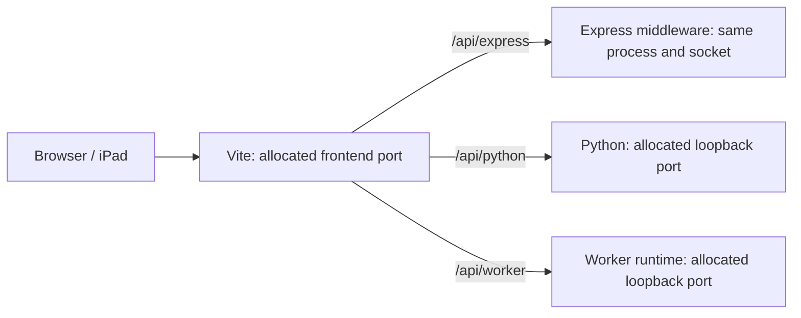
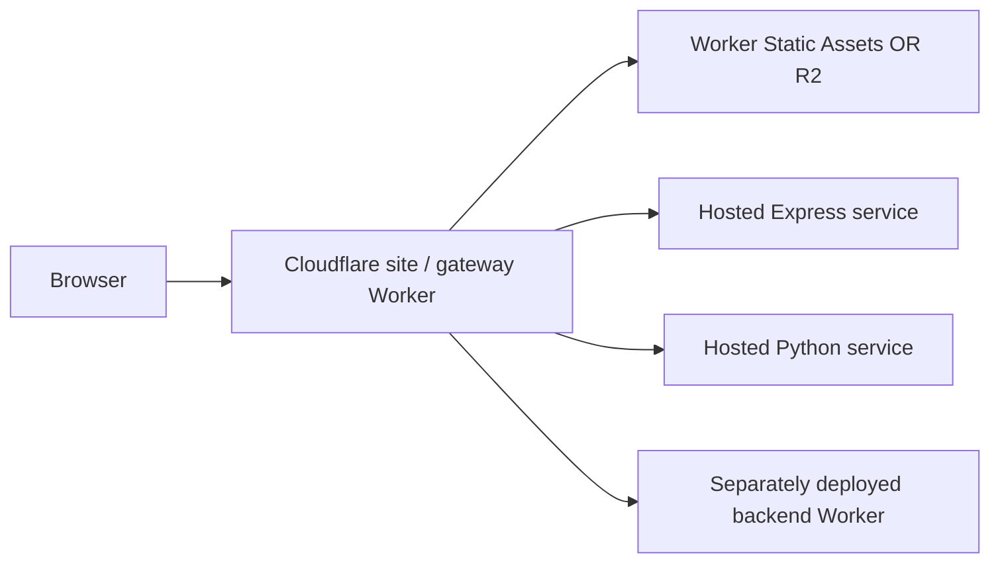

# One frontend, three backends

This spike starts a static Vite app, an Express app, a Python process, and a local
Cloudflare Worker with one command. Each launch owns its processes, ports, Vite
caches, and temporary Worker storage. The frontend uses the same relative API
paths in development and production.

## Run it

Requires Node 24.5+ and Python 3.10+ on macOS or Linux. No Cloudflare account or
Python dependencies are needed for local development and tests.

```sh
cd experiments/dev-stack
npm ci
npm run dev
```

Open one of the printed Vite URLs and click each backend's button. An iPad on the
same network can use a printed LAN URL. Only the frontend listens on the LAN;
the Python and Worker listeners remain on the Mac's loopback interface.

Run the same command in a second terminal. Vite finds another frontend port;
the OS independently allocates both backend ports. Each backend response has an
`instance` ID and a request counter, making it easy to see which stack answered.
Counters are demonstration state, not durable storage.

```sh
npm run dev -- --port 5300                 # prefer a frontend port; allow fallback
npm run dev -- --port 0                   # let the OS allocate the frontend too
npm run dev -- --host 127.0.0.1            # keep the entire stack local
PYTHON=/path/to/python npm run dev         # select a Python interpreter
```

Ctrl-C, SIGTERM, or Vite's `q` shortcut stops the stack and removes its temporary
state. A backend crash closes the stack and makes the CLI exit unsuccessfully.
Startup failures and interrupted startup also clean up owned backends. Cleanup
signals only the process groups created by this launch; it never finds and kills
an arbitrary process by port.

This experiment uses its own npm lockfile. It is deliberately outside the root
pnpm workspace: installing it does not change root dependencies, workspace
membership, package versions, or published packages.

## Development wiring



| Browser route | Backend receives | Dev implementation |
| --- | --- | --- |
| `/api/express/info` | `/info` | Express app mounted in Vite's middleware stack |
| `/api/python/info` | `/info` | Vite proxy to the reported Python URL |
| `/api/worker/info` | `/info` | Vite proxy to the reported Worker URL |

Each backend also implements `POST /echo`. Paths, query strings, and request
bodies pass through. The proxy enables WebSocket forwarding for separate
services, although these example backends only implement ordinary HTTP.

The startup order is backend initialization → readiness messages → health probes
→ Vite creation with the discovered proxy targets → frontend listening. The
backends usually do not need the frontend port at all. If a backend needs an
exact callback URL, provide it after Vite's `listen()` completes, or configure a
stable external callback origin explicitly; guessing `5173` is unreliable.

## Small pieces to reuse

| File | Responsibility |
| --- | --- |
| `infrastructure/ready.py` | One Python function for emitting the readiness message |
| `infrastructure/ready.mjs` | The matching Node function |
| `infrastructure/process-backend.mjs` | Spawn an executable, read its URL, optionally probe it, stop its process group |
| `infrastructure/backend-plugin.mjs` | Mount apps and configure Vite proxies for supplied service handles |
| `infrastructure/stack.mjs` | Example composition and ownership of a whole dev instance |
| `backends/worker/dev.mjs` | Worker-specific adapter using the official Cloudflare Vite plugin |

The backend convention is just one newline-terminated JSON message on stdout:

```json
{"type":"dev-ready","url":"http://127.0.0.1:43827/"}
```

Emit it after the server has bound its socket and completed initialization.
Flush stdout (the Python helper does this). Send the actual bound port, not the
requested port `0`. Other log lines are allowed; they are prefixed by service
name. A readiness timeout prevents silent hangs. An HTTP health probe is
optional in the reusable adapter; this composition supplies `/info` for its
example services.

The adapter returns `{ name, url, pid, stop }`. A future backend needs only an
adapter returning a URL and a cleanup function; it need not adopt Express,
Python's standard library, or this application's routing.

### Python

The demo uses `ThreadingHTTPServer` to avoid a Python install step:

```py
server = ThreadingHTTPServer(("127.0.0.1", 0), Handler)
report_ready(f"http://127.0.0.1:{server.server_port}/")
server.serve_forever()
```

For an existing ASGI backend, Uvicorn supports port `0`, a supplied socket, and
an inherited file descriptor. A thin runner can create and retain the socket,
pass it to Uvicorn, and report its address once startup is complete. Do not bind
an available port, close the socket, and then ask the backend to rebind that
number: another agent can claim it in between. The reporting helper is
independent of the Python framework. [Uvicorn socket settings](https://github.com/Kludex/uvicorn/blob/main/docs/settings.md)

### Express

`createApp()` exports an Express app without calling `listen()`. Vite mounts it
under `/api/express`, so it needs no additional socket. The separate
`backends/express/server.mjs` is a conventional hosted-service entry point and
also demonstrates reporting a dynamically allocated Node port.

### Cloudflare

A Worker does not own its HTTP listener: its host runtime does. The small Node
runner starts that runtime through `createServer()` and the official
`@cloudflare/vite-plugin`, then reports the bound address. The Worker application
itself needs no port-reporting code.

The runner uses a child process to keep toolchain global state separate from the
frontend Vite process. It gives each instance a unique local Worker name and its
own persistence and cache directories, disables the fixed debugger port, and
disables remote bindings.
Express and Python are not hot-reloaded here. The Worker retains the official
plugin's reload behavior. [Cloudflare plugin configuration](https://developers.cloudflare.com/workers/vite-plugin/reference/api/)

The custom Vite plugin handles routing; the launcher handles lifecycle. This
keeps a plain `vite build` from launching services and gives startup failures a
single cleanup owner. The launcher could later become a reusable package without
changing the backend convention. Vite itself provides both
[middleware/proxy hooks](https://vite.dev/guide/api-plugin.html#configureserver) and a
[programmatic server API](https://vite.dev/guide/api-javascript).

## Production wiring



Production does not run Vite or the dev supervisor. The site Worker implements
the browser-facing routing and reads backend origins from its environment.
The frontend build embeds no local backend ports, instance IDs, or origin URLs.

`deploy/gateway.mjs` shares API routing between the two site Workers. It strips
`/api/<name>`, preserves a configured upstream base path, forwards the method,
body, and query, streams the response, and returns JSON on configuration or
connection errors. Unknown `/api` routes return 404 rather than static HTML.
Backend origins are fixed deployment configuration, not browser-supplied URLs.

The backend Worker and the site Worker are distinct deployments. The example
uses an HTTPS origin for the backend Worker. A service binding would be a natural
alternative when both Workers belong to your account; it changes the gateway's
transport, not the browser API paths.

### Deployment preparation

```sh
npm run build
npm run check:deploy
```

`build` only builds `app/` into `dist/`. `check:deploy` builds and runs Wrangler's
local **dry-run** packaging checks for all three Worker configurations; it does
not upload or deploy anything. Tests also exercise both site Workers inside
workerd, including actual local R2 storage.

Deploy Express and Python to your preferred container or application hosts. The
included Dockerfiles use the experiment directory as their build context:

```sh
docker build -f backends/express/Dockerfile -t dev-stack-express .
docker build -f backends/python/Dockerfile -t dev-stack-python .
```

Both support the host's `PORT` convention and bind all interfaces in the
container. The Python HTTP server is an intentionally small demonstration;
replace it with your production ASGI/WSGI service when adopting this pattern.

The following commands are examples for a later, deliberate deployment. They
require your Cloudflare login and real backend origins; this spike has not run
them against your account.

### Option A: Worker Static Assets

1. Deploy the backend Worker with
   `npx wrangler deploy --config backends/worker/wrangler.jsonc`.
2. Replace the three placeholder origins in `deploy/wrangler.assets.jsonc` with
   the deployed services' addresses.
3. Run `npm run build`, then
   `npx wrangler deploy --config deploy/wrangler.assets.jsonc`.

The site Worker delegates non-API requests to its `ASSETS` binding. This spike
uses `run_worker_first: true` so routing is explicit for every request. A larger
site can selectively run the Worker first for API routes and let assets bypass
it. [Static Assets routing and bindings](https://developers.cloudflare.com/workers/static-assets/binding/)

### Option B: R2-backed static content

1. Create an R2 bucket and put its name in `deploy/wrangler.r2.jsonc`.
2. Replace the backend origin placeholders there.
3. Run `npm run build`.
4. Upload files with
   `node deploy/upload-r2.mjs <bucket-name> releases/<release-id>`.
5. Set `STATIC_PREFIX` to that release prefix and deploy with
   `npx wrangler deploy --config deploy/wrangler.r2.jsonc`.

The upload script explicitly targets remote R2 and sets content types. Vite's
hashed files receive immutable cache metadata; HTML revalidates. Uploading a new
release prefix before switching the Worker avoids serving a half-uploaded site.
Keep the old release prefix for rollback.

The R2 site Worker maps `/` to `index.html`, returns missing files as 404,
preserves object HTTP metadata, and supports HEAD and ETag revalidation. It has
no automatic SPA fallback or range-request implementation; add those policies
if your real site needs them. It streams R2 objects rather than loading the
entire object into memory. [R2 Worker API](https://developers.cloudflare.com/r2/api/workers/workers-api-reference/)

### Separate origins and production policies

An external SaaS endpoint can remain a direct browser call. For a local backend
that must also be called directly, expose an address the browser can reach and
configure CORS; `127.0.0.1` on an iPad points at the iPad. This example keeps all
three application APIs behind the site origin.

This gateway is a routing example. Authentication, backend credentials, cookie
domain rewriting, and absolute redirect rewriting belong to the real service's
contract. API replies are not cached. The dev proxy allows WebSockets, but the
production gateway has not implemented or tested WebSocket upgrade forwarding.
If you change a route prefix, change it in the dev plugin and the production
gateway together; the browser contract should stay consistent.

Local process groups make shutdown ownership explicit on macOS/Linux. Graceful
termination is covered; SIGKILL of the supervisor or a machine crash cannot run
its cleanup code. A stronger host-level process supervisor is needed if cleanup
must be guaranteed after forced termination. Separate ports also do not isolate
an external database or SaaS account: use instance-specific namespaces when
those services must be independent.

## Verification

```sh
npm test
npm run check:deploy
```

Tests cover simultaneous dev stacks, frontend port fallback, independent backend
identities and storage directories, GET/POST proxying, unknown routes, teardown,
backend crashes, startup interruption, readiness timeouts, production API
forwarding, and both deployment gateways in the actual Workers runtime.

Read `infrastructure/stack.mjs` first to see the composition, then the routing
plugin and process adapter to see what can be extracted into other projects.
