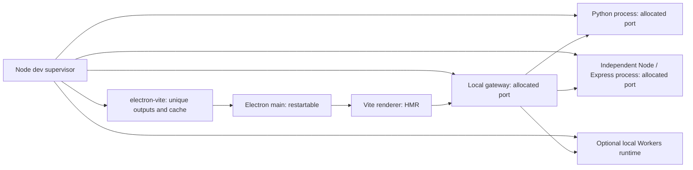
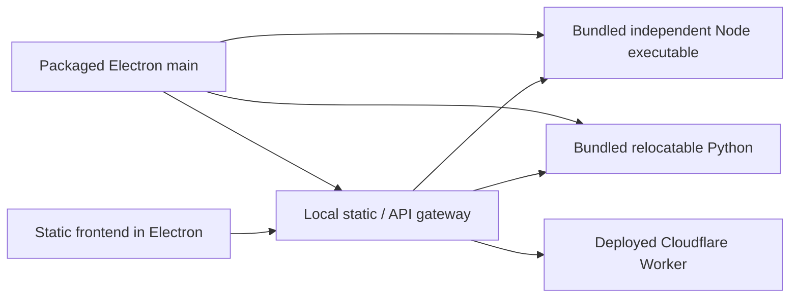

# Electron stack

One static frontend and three backends, demonstrated as both a web-style desktop
package and a desktop-specific application. Express and Python run on the user's
computer. The Cloudflare backend is an independently deployed service; local
development can start a Workers runtime instead.

See the [cross-spike architecture review](../architecture-review.md) for reviewed
patterns, fixes to development routing and lifecycle, and Mac distribution limits.

## Run the development modes

Requires Node 24.5+ and Python 3.10+ on macOS or Linux. This is a standalone npm
experiment outside the published pnpm workspace. It reuses the previous spike's
process adapter directly from `../dev-stack/`; Electron's main build bundles
that source, so packaged applications have no sibling-repository dependency.

```sh
cd experiments/electron-stack
npm ci
npm run setup:electron
npm run dev -- --mode web
```

`setup:electron` explicitly downloads the Electron binary if npm's install-script
policy skipped its installer. It is safe to rerun when the binary is already
present. The renderer, main process, preload, and shared service supervisor are
TypeScript source. The existing Express/Python/Worker examples retain their
small entry points and the same readiness convention as the previous spike.

| Mode / command | What it demonstrates |
| --- | --- |
| `npm run dev -- --mode web` | Browser-compatible UI in a normal Electron window, with no Node or preload APIs in the renderer |
| `npm run dev -- --mode desktop` | Frameless, always-on-top panel; menu-bar/tray actions; typed preload bridge; native file chooser |
| `npm run dev -- --mode node-direct` | Explicit experiment with Node enabled directly in the renderer, with sandbox and context isolation disabled |
| `npm run dev -- --hidden --mode desktop` | Real Electron and real renderers with invisible windows and no tray icon |
| `npm run dev -- --browser-only` | The web frontend and backends without starting Electron |

The desktop mode's close button hides the panel. Use the tray/menu-bar menu to
show it or quit. The Hide button also hides it. Hidden mode skips the tray, and
closing its window exits the app. Stop the dev command with Ctrl-C or SIGTERM
to stop everything it owns.

By default the dev command starts a local Cloudflare Worker. To exercise your
deployed Worker instead:

```sh
npm run dev -- --hidden --worker-url https://your-api.example.com
```

The backend endpoint contract is `GET /info` and `POST /echo`. Each frontend call
uses `./api/express`, `./api/python`, or `./api/worker`. Responses show which
backend and instance handled the request. This HTTP contract stays the same in
the normal browser, Electron dev, and packaged application.

## Ownership and isolation



In development, the supervisor owns the compute services, while `electron-vite`
owns the Electron process and renderer dev server. Restarting main changes its
PID but preserves backend PIDs, ports, counters, and the frontend URL. Preload
changes rebuild the preload and reload the renderer; renderer changes use Vite
HMR. The renderer removes event listeners on hot disposal to avoid duplicated
backend requests after an update. Express and Python do not hot reload here.

Every launch has a fresh temporary directory containing its profile, session
cache, Worker state, Vite caches, and generated main/preload builds. There is no
single-instance lock. This allows multiple agents to run the same checkout
concurrently without replacing each other's compiled Electron entry points.
Separate checkouts/worktrees are still preferable when agents edit conflicting
source files; every live instance sees shared source edits in one checkout.

Express and Python ask the OS for port `0` and report the actual port through the
`dev-ready` JSON line. The gateway does the same. The Worker and renderer use
Vite's bind-and-retry port selection. This experiment pins Vite 7 because the
current `electron-vite` release declares Vite 5–7 compatibility; Vite 7 treats
configured port `0` as its default, so the Worker explicitly allows port fallback.
No separate free-port probe/rebind race is used.

Browser-only mode owns a Node HTTP listener on port `0` and mounts Vite in
middleware mode. This keeps shutdown under the supervisor: standalone Vite's
SIGTERM handler would otherwise exit the process before backend cleanup finishes.
Both frontend modes use `infrastructure/gateway-proxy.ts`; its target is an origin
and its rewrite adds the private gateway prefix exactly once.

The gateway only binds loopback and uses a random per-instance URL prefix. The
packaged static app is served from that prefix. In development, Vite proxies the
same browser API paths to it. Root requests without the prefix return 404. This
avoids making a privileged compute API available at an easily guessed local
URL. The random prefix is a bearer capability; do not intentionally expose it
to untrusted pages.

This prefix is not full API authentication. Development Vite exposes predictable
`/api` routes, and the individual backend listeners remain reachable on loopback.
A product with privileged operations needs explicit origin/access checks at its
ingress points before reusing this routing example.

The example gateway forwards ordinary HTTP requests. WebSocket upgrades, custom
authentication, upstream cookie domains, and redirect rewriting need explicit
adapters if the real application uses them.

Graceful shutdown waits for the Electron process group, closes the gateway and
compute backends, and removes temporary state. SIGKILL of a supervisor or a
machine crash cannot run cleanup code. The process adapter is POSIX-specific;
Windows Job Objects and Windows runtime packaging are outside this spike.

## Packaged application



When the app is packaged, the main process calls the same `startServices()`
function and owns the compute processes itself. The frontend is built static
content inside `app.asar`. Executables, backend files, and Express dependencies
live in ordinary `Contents/Resources` directories outside ASAR. Node and Python
are independent executables; neither Express nor Python depends on Electron's
embedded Node runtime or a user's installed interpreter.

Set `mode` and the deployed `workerUrl` in `app-config.json` **before packaging**.
The default Worker URL is a placeholder. The packaged app does not bundle or
launch a local Cloudflare Worker and does not deploy one. A `WORKER_URL`
environment override exists for testing; a Finder-launched app normally uses
its bundled configuration. `APP_MODE` is also an optional launch override.

The app uses temporary profiles by default so packaged spike instances can run
concurrently. `APP_PROFILE` can select a persistent profile, which is then not
deleted on exit. Do not share that profile between simultaneous instances.
Real product persistence and migrations should be designed separately from this
development isolation convention.

### Bundle the runtimes

```sh
npm run runtimes
npm run runtimes -- --check
npm run runtimes -- --offline
```

The staging script downloads a pinned official Node distribution and a pinned
Astral `python-build-standalone` install-only distribution for the host OS and
architecture. It verifies published SHA-256 metadata, checks relocated runtimes
under a scrubbed environment, and writes a provenance manifest. The Python
checks include `ssl`, `sqlite3`, and `ctypes`. Python bytecode generation and
user-site imports are disabled for application backends, so normal execution
does not modify the signed bundle.

See [runtime packaging](./docs/runtimes.md) for the sources, dependency strategy,
cross-platform limits, sizes, and how native libraries enter the signing flow.
Adding a Rust/C++ backend follows the same model: ship its executable and required
libraries as resources and give the process adapter its command, arguments, and
readiness protocol. Its compilation is a separate build step.

### Build a bundle or unsigned DMG

```sh
npm run package:dir
npm run package:dmg                 # macOS
```

These commands build TypeScript/static assets, stage the independent runtimes,
and install locked production Express dependencies in an isolated staging
directory. Builder writes output under `artifacts/`. They explicitly disable
signing-identity discovery and make no notarization submission. The inspected local
bundle has no valid application distribution signature: residual executable
signatures do not provide a sealed, Developer ID signed app. See the review for
the actual signature checks and why a Dropbox copy may still launch. On Linux,
`package:dir` builds an unpacked directory; the builder config also supplies an
AppImage target. Build and stage runtimes on the target OS/architecture.

The packaging metadata reads the repository's CI-managed version and supplies
it to the generated application. No source `package.json` version or plugin
manifest version is changed. Generated/runtime/build artifacts are ignored.

### Signed direct-download distribution

The default packaging lane is deliberately unsigned. For a later signed build:

```sh
ELECTRON_STACK_SIGN=1 \
ELECTRON_STACK_SIGN_IDENTITY='Developer ID Application: Your Team (TEAMID)' \
CSC_IDENTITY_AUTO_DISCOVERY=true npm run package:signed
```

To additionally request notarization, set `ELECTRON_STACK_NOTARIZE=1` and provide
the credentials supported by electron-builder. No credentials are stored in
this experiment. The signing lane enables hardened runtime, supplies JIT
entitlements, and inventories native bundled binaries and libraries for signing.
The follow-up [macOS notarization spike](../macos-notarization/README.md) verified
Developer ID signing of the app, DMG and nested Node/Python code, plus execution
of the copied signed app. Apple accepted the DMG; its ticket was stapled and
validated. The spike documents reusable credentials and the actual timings.

[macOS and Linux distribution](./docs/distribution.md) explains Developer ID,
notarization/stapling, internal Gatekeeper overrides, nested binaries, and
runtime permissions. Internal use is not a Gatekeeper exemption; a trusted
unsigned build can require an explicit user override, and managed devices may
disallow it. App Store/TestFlight distribution and the App Sandbox are not
required for this direct-download design.

## Desktop APIs and quiet testing

Web mode gives the renderer browser APIs only. Desktop mode also exposes a
typed `window.desktopAPI` bridge for a small allowlist of operations. Main
validates the sender, frame and application document URL and checks argument
types. Navigation and redirects outside that document path, including API HTML,
and new windows are blocked; permission requests are denied unless a
product explicitly implements the corresponding capability. The native file
chooser is an explicit desktop action, not a renderer filesystem escape hatch.

Node-direct mode proves direct Node access is possible, but it disables renderer
sandboxing and context isolation. It is a comparison mode, not necessary for
frameless windows, tray apps, filesystem actions, or backend compute. Keep the
typed bridge as the normal desktop design. Do not load third-party application
code into that privileged renderer.

`--hidden` means **hidden Electron windows**, not a headless Electron runtime.
The tests assert that every window stays invisible. macOS still requires a GUI
session. Linux CI can run Electron under Xvfb; `--browser-only` also allows
ordinary headless Chromium tests for the web UI without running Electron.
See [workflow findings](./docs/workflow.md) for current primary-source references
and the process/reload boundaries.

## Verification

```sh
npm run typecheck
npx playwright install chromium    # once, for the Vite frontend button tests
npm test
npm run package:dir
npm run test:packaged
npm run package:dmg
npm run test:dmg                   # mount, copy, detach, test the copied app
```

Tests cover simultaneous hidden dev commands and unique output/profile paths,
main restart without backend restart, preload reload, hidden web/desktop/direct-
Node windows, GET/POST requests to all three services, bridge argument validation,
independent instances, and shutdown that leaves other instances running. They
also exercise buttons through the actual Vite proxy in desktop development and
browser-only mode, interrupted startup, truncated upstream replies, client
cancellation, and navigation/IPC rejection for backend HTML and redirects.

The packaged smoke test launches the actual app bundle with `PATH=/nonexistent`,
checks backend process command lines point into bundled Node/Python, exercises
all three backend routes, and verifies process cleanup. Its Worker fixture runs
separately from the app to simulate the deployed service boundary. Override
`PACKAGED_EXECUTABLE` if your bundle has another executable path.

`test:dmg` runs that smoke test on a fresh copy extracted from the DMG after
detaching the image. It accepts an optional explicit image path. This checks
relocation and runtime completeness, not Gatekeeper acceptance of a downloaded
artifact opened through Finder on a fresh recipient Mac.

Verified on this host: macOS arm64, hidden Electron operation, concurrent stacks,
TypeScript/build/lint, independent runtime relocation, unsigned app packaging,
unsigned DMG creation, Developer ID signing, signed nested runtime execution,
Apple notarization/stapling, and the packaged app without system runtimes.
Linux/Intel builds and Gatekeeper on a fresh recipient's downloaded artifact have
not been exercised. Native file-dialog user
interaction and tray/menu clicks are manual checks; hidden tests intentionally
avoid those visible OS surfaces.
