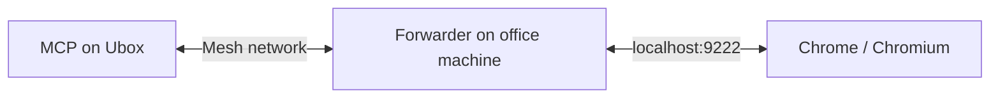
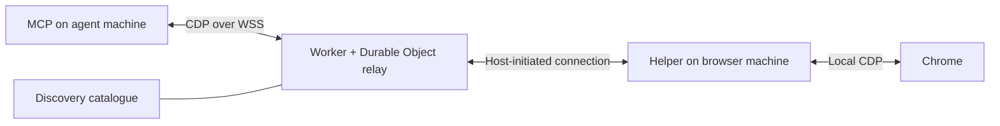

# Remote browser connectivity and discovery

Investigation recorded **2026-10-11**. Connection options are ordered from the least additional
infrastructure to a custom relay. The examples describe configurations to arrange; they do not
indicate that Cloudflare services or a Cloudflare provider have been provisioned or tested here.

Keep the browser on the machine where its profile, cookies, and human user live. Run Chrome
DevTools MCP alongside Claude Code or Codex on the development machine. Connect those machines
using an existing network or tunnel, with an external provider handling discovery and credentials.
The connection carries Chrome DevTools Protocol (CDP), independently of the agent's MCP connection.

The intended everyday experience is to choose a named browser once, remember it for a directory,
and subsequently run `aibr claude` or `aibr codex`. The name should survive changes to ports,
hostnames, credentials, and transport.

| Option | Additional setup | Authentication | Fit with aibr today |
| --- | --- | --- | --- |
| Existing endpoint or SSH forward | Reuse a working connection | Existing network or SSH credentials | Directly supported |
| Existing mesh network | SSH over the mesh, or a local forwarder on the browser host | Mesh policies; optionally a proxy token | Local endpoint works; token headers need an adapter |
| Cloudflare Tunnel with a local TCP listener | `cloudflared` on both machines, a route, and Access policies | Human login or service token | Local endpoint works; Cloudflare provider not implemented |
| Cloudflare Tunnel with direct HTTPS/WSS | Published HTTP route, Access, endpoint resolution | Headers on HTTP requests and WebSocket handshake | MCP supports headers; aibr/provider v1 does not |
| Custom Worker and Durable Object relay | Host connector, rendezvous, authentication, relay, discovery | Designed and operated by the service | Can fit the provider interface; not implemented |

The ordering assumes an existing SSH account or mesh where those options are used. A managed
Cloudflare Tunnel may be less operational work than setting up a new mesh or writing a proxy.

## 1. Reuse an endpoint or SSH connection

If an authenticated forward already presents the browser on a local port, the agent-side command
is simply:

```sh
aibr codex --endpoint http://127.0.0.1:19222
# Equivalent shorthand:
aibr codex --connect-port 19222
```

Here and below, Chrome's example port is **9222 on the browser machine**, while **19222 is on
the agent machine**. The browser must already be running with debugging enabled.

When the agent machine can SSH to the browser machine, run this on the **agent machine**:

```sh
ssh -N -L 127.0.0.1:19222:127.0.0.1:9222 browser-host
```

If connectivity is available in the opposite direction, run this on the **browser machine**:

```sh
ssh -N -R 127.0.0.1:19222:127.0.0.1:9222 agent-host
```

Keep the forward running in another terminal or under a service manager. Both examples provide
the same agent-side endpoint. See the existing [provider examples](../providers.md#manual-ssh-examples).

aibr probes the endpoint using CDP before launching the agent. Endpoint mode attaches to an
existing browser; it does not start a browser on either machine. Persistent browser and tunnel
lifetimes remain independent of the agent.

## 2. Use an existing mesh network

Cloudflare Mesh assigns participating devices private addresses and carries TCP traffic between
them through Cloudflare. Its documented use cases include long-lived connections. This supplies
network reachability between the office machine and Ubox without publishing an application
through a separate Cloudflare Tunnel. [Cloudflare Mesh concepts](https://developers.cloudflare.com/mesh/concepts/)

### Chrome's loopback restriction still applies

The normal Chrome/Chromium debugger listener explicitly tries `127.0.0.1`, then `::1`. It is
not just a default that `--remote-debugging-address=0.0.0.0` overrides in that implementation.
Modern Chrome's headless mode shares the normal browser implementation. The current standalone
headless shell's ordinary port-listening path also uses loopback. Historical advice about
different builds and headless modes should not be treated as a portable launch recipe.
[Chrome listener source](https://github.com/chromium/chromium/blob/main/chrome/browser/devtools/remote_debugging_server.cc),
[headless mode](https://developer.chrome.com/docs/automation-and-testing/headless),
[headless shell listener](https://github.com/chromium/chromium/blob/main/headless/lib/browser/headless_devtools.cc)

Chrome has no built-in CDP shared-secret/password setting. A mesh address alone therefore does
not expose its loopback debugger port. Use SSH over the mesh, or place a forwarder on the browser
machine:



For a dedicated forwarder, choose between network authorization through mesh policies and an
additional application token. The latter needs an HTTP/WebSocket proxy that checks the token
before forwarding HTTP requests or accepting a WebSocket upgrade. A plain TCP forward cannot
perform that HTTP token check. Expose the forwarder through the mesh; listening on all interfaces
also makes other attached networks relevant to its access policy.

This is a proposed deployment arrangement, not an aibr feature. A provider can hide the network
details and return a local endpoint. Direct token-protected endpoints would require generic
header support in aibr's probes as well as its MCP launch configuration.

## 3. Use Cloudflare Tunnel with a local TCP listener

Cloudflare separates connectivity from authorization:

| Component or credential | Purpose |
| --- | --- |
| Tunnel and its connector credential | Authorize `cloudflared` on the browser host to establish the tunnel |
| Published route | Map an application hostname to a service on that host |
| Access application and policies | Decide which people or service credentials may use the hostname |
| Access service token | Identify a machine client using a client ID and client secret |

The tunnel's run token is not the credential to distribute to browser clients. Publishing a
route alone does not establish the desired user allowlist; configure Access for that hostname.
[Tunnel setup](https://developers.cloudflare.com/tunnel/get-started/),
[tunnel credentials](https://developers.cloudflare.com/tunnel/reference/tunnel-tokens/),
[Access policies](https://developers.cloudflare.com/cloudflare-one/access-controls/policies/)

### One-time setup

On the browser side, create a named tunnel, run its connector as a background service, and map
an example hostname `office-browser.example.com` to **`tcp://127.0.0.1:9222`**. Protect the
hostname with an Access application. Multiple profile ports can have separate routes through
one connector.

For a person, an **Allow** policy can select an email address or identity-provider group. For
unattended access, use a **Service Auth** policy selecting a service token such as “Ubox browser
access.” Merely creating a service token does not authorize it for the application.
[Service authentication](https://developers.cloudflare.com/cloudflare-one/access-controls/service-credentials/service-tokens/)

### Human login from a headless remote machine

On **Ubox**, run:

```sh
cloudflared access login --quiet https://office-browser.example.com
```

The command prints a special URL and waits. Open that URL in the browser on your **laptop** and
complete the configured login. Leave the Ubox command running: it receives and caches its token
automatically. `--quiet` suppresses printing the resulting JWT, while leaving the login URL
available. Authentication is subject to the Access policy and expires according to its session
settings. [CLI login documentation](https://developers.cloudflare.com/cloudflare-one/tutorials/cli/),
[login command source](https://github.com/cloudflare/cloudflared/blob/master/cmd/cloudflared/access/cmd.go)

The handoff uses Cloudflare's transfer service. The remote process generates encryption keys,
prints the login URL, and polls for an encrypted token addressed to that process. A callback
server on Ubox is not required, nor is SSH forwarding for the login callback.
[Token transfer implementation](https://github.com/cloudflare/cloudflared/blob/master/token/transfer.go)

### Machine authentication

For unattended operation, provision an Access service token through the user's credential
management system. `cloudflared access tcp` accepts `TUNNEL_SERVICE_TOKEN_ID` and
`TUNNEL_SERVICE_TOKEN_SECRET`, as well as corresponding command-line flags. A provider can load
these without putting credentials in a project file. These are Access credentials, distinct
from the browser host's tunnel run token.
[Client flags and environment variables](https://github.com/cloudflare/cloudflared/blob/master/cmd/cloudflared/access/cmd.go)

### Connect on the agent machine

After login or service-credential setup, run this on **Ubox**:

```sh
cloudflared access tcp \
  --hostname office-browser.example.com \
  --url 127.0.0.1:19222
```

Keep it running; in another terminal:

```sh
aibr codex --connect-port 19222
```

Cloudflare carries the TCP stream over a WebSocket connection. Chrome's HTTP discovery and CDP
WebSocket both travel inside that stream. The MCP does not need Cloudflare headers, and aibr
discovers the browser's changing WebSocket path automatically.
[Client-side TCP workflow](https://developers.cloudflare.com/cloudflare-one/access-controls/applications/non-http/cloudflared-authentication/arbitrary-tcp/)

Cloudflare recommends **Client-to-Tunnel/private-network connectivity for long-lived sessions**
instead of this published TCP mechanism. Treat the local listener as an easy integration path,
and evaluate idle behavior and reconnects for all-day agent sessions. An existing mesh may be
a better fit. Reconnecting a transport does not restore a lost CDP session's state.
[Protocol guidance](https://developers.cloudflare.com/cloudflare-one/networks/connectors/cloudflare-tunnel/routing-to-tunnel/protocols/)

## 4. Publish HTTP and WebSocket access directly through Tunnel

An alternative route points the hostname at **`http://127.0.0.1:9222`**. The remote client can
then use HTTPS for discovery and WSS for CDP without its own `cloudflared` TCP listener.
Cloudflare supports WebSockets; Access credentials are supplied with the initial HTTP upgrade.
Idle connections need keepalives, and network maintenance can disconnect them.
[WebSocket support and connection behavior](https://developers.cloudflare.com/network/websockets/)

This requires a few client/proxy accommodations:

- Authenticate both `/json/version` and the WebSocket handshake. Access service-token headers
  are `CF-Access-Client-Id` and `CF-Access-Client-Secret`. Human sessions can use an application
  token via `cf-access-token`. [Authentication options](https://developers.cloudflare.com/cloudflare-one/access-controls/authenticate-agents/)
- Chrome checks the HTTP `Host` header. Configure the origin Host header to an accepted local
  value, such as `localhost:9222`, when needed. Cloudflare exposes `httpHostHeader` for this.
  [Origin configuration API](https://developers.cloudflare.com/api/resources/zero_trust/subresources/tunnels/subresources/cloudflared/subresources/configurations/),
  [Chrome HTTP handler](https://github.com/chromium/chromium/blob/main/content/browser/devtools/devtools_http_handler.cc)
- Discovery may advertise `ws://localhost:9222/devtools/browser/<id>`. Preserve the browser path
  while replacing the scheme and authority with the externally reachable WSS address. Do not
  save the generated browser ID as the permanent identity of the profile.

Chrome DevTools MCP 1.10.1 accepts `--wsEndpoint` and `--wsHeaders`. Illustrative invocation,
using placeholders rather than real credentials:

```sh
chrome-devtools-mcp \
  --wsEndpoint='wss://office-browser.example.com/devtools/browser/BROWSER_ID' \
  --wsHeaders='{"CF-Access-Client-Id":"CLIENT_ID","CF-Access-Client-Secret":"CLIENT_SECRET"}'
```

The caller must discover the current browser ID first. MCP's `--wsHeaders` option applies to
the direct WebSocket mode; it is not a general HTTP-discovery-header option in that release.
[MCP browser options](https://github.com/ChromeDevTools/chrome-devtools-mcp/blob/chrome-devtools-mcp-v1.10.1/src/config/browser-options.ts)

Current aibr already rehosts discovered WebSocket URLs and probes the connection, but neither
its probes nor provider v1 support custom authentication headers. A local authenticated adapter
works with the existing interface. Generic credential/header support would need to cover both
the readiness probe and the final MCP connection. [Current probes](../../src/cdp.ts),
[MCP configuration](../../src/agents.ts)

## 5. Build a custom Worker and Durable Object rendezvous relay

This is the most infrastructure to own, but permits a purpose-built browser registry and
connection policy. It was the original design possibility, not a requirement for aibr.



Both machines initiate outbound connections. The browser-host helper registers a stable
profile identity and maintains a connection to the relay. When a client selects that browser,
the relay pairs the client with a connection to the local Chrome socket. Neither machine needs
an inbound public port.

The relay should preserve opaque CDP messages, including command IDs and session IDs. Open a
separate upstream Chrome connection for each client. If multiple connections share a host
tunnel, multiplex **connections** in an outer envelope; avoid merging independent clients'
CDP command streams into one browser connection. Separate connections do not isolate shared
tabs, cookies, navigation, or browser-wide operations.

Durable Objects can coordinate the paired sockets. Use accepted inbound sockets on both sides
with the WebSocket hibernation API; outgoing WebSockets do not hibernate. Persist enough socket
attachment metadata to reconstruct pairings after hibernation. Service restarts and disconnects
still need explicit recovery behavior.
[Durable Object WebSockets](https://developers.cloudflare.com/durable-objects/best-practices/websockets/)

Received WebSocket messages are limited to **32 MiB**. A direct MCP connection cannot be assumed
to fit that limit for every screenshot, trace, or evaluation result. A generic tunnel with
helpers on both ends can chunk and reassemble opaque data; splitting WebSocket frames alone
does not bypass a limit on the reassembled message.
[Durable Object limits](https://developers.cloudflare.com/durable-objects/platform/limits/)

Other work the service would own includes per-browser authorization, registration expiry,
connection readiness, bounded queues/backpressure, ordering, close/error propagation, and
browser-instance changes. Authentication protects both discovery and browser control. Avoid
silently replaying commands after a disconnect: the browser may already have performed them.

A direct WSS entry point minimizes HTTP emulation. To support clients using `--browserUrl`, also
provide the expected discovery endpoint with reachable WebSocket URLs. A full debugger-port
relay can instead forward HTTP and upgraded connections more generally. An optional agent-side
helper can present a local port and hide authentication and tunnel framing from MCP.

### The existing intent-panel relay is a useful reference

The older checkout is `~/src/pdum-aiui-intent-tool-v0`. Its
[`cdp-proxy.ts`](https://github.com/habemus-papadum/pdum-aiui-intent-tool-v0/blob/98e0140bd9a739198c879f2b921628bc17911b9a/packages/aiui-intent-client/src/cdp-proxy.ts)
fetches `/json/version`, resolves the browser socket, accepts `/intent/cdp` connections, and
forwards text messages unchanged in both directions. It queues initial messages while the
upstream connection opens and gives each client a separate upstream socket.

It implements a WebSocket bridge, not a mirror of every HTTP debugger endpoint. Its destination
is deliberately limited to loopback, and it does not provide the authentication, discovery
service, or bounded buffering needed for a general remote deployment. The separate
[`cdp-bus.ts`](https://github.com/habemus-papadum/pdum-aiui-intent-tool-v0/blob/98e0140bd9a739198c879f2b921628bc17911b9a/packages/aiui-intent-client/src/cdp/cdp-bus.ts)
implements the panel's CDP operations. The bridge carries browser-control traffic; Chrome still
loads websites using its own network connection.

## Discovery and the aibr user experience

Keep three responsibilities distinct:

| Responsibility | Owner |
| --- | --- |
| Browser process, profile, cookies, launch settings | Browser-host tools, including aibr for managed local profiles |
| Catalogue, credentials, mesh/tunnel setup and lifetime | User-provided external provider or service |
| Selection, readiness check, MCP configuration, exec of agent | aibr on the agent machine |

A Cloudflare tunnel is not itself a catalogue of browser profiles. A provider could read a
small user-configured catalogue, a shared registry, or Cloudflare API metadata. Start with
friendly names and stable IDs, for example `office/research`, mapped to the current hostname.
Account-wide Cloudflare management credentials need not be distributed to every browser client
merely to read a supplied catalogue and connect.

### Supported integration today

The [provider protocol](../providers.md) already has these operations:

- `discover`: return candidate IDs, labels, and optional host/detail text without opening tunnels.
- `resolve`: return a reachable URL or `needsConnect`; remain read-only.
- `connect`: idempotently prepare connectivity and return a URL, then exit.

For a provider that has been installed and configured externally:

```sh
# One-time registration and selection on the agent machine:
aibr provider add browsers --command /absolute/path/to/browser-provider
aibr provider discover browsers
aibr target add office --provider browsers --id office/research
aibr init --target office

# Subsequent launches from this directory:
aibr codex
aibr claude

# To discover and choose another target interactively:
aibr codex --pick
```

`browser-provider` is an illustrative external executable, not a shipped Cloudflare adapter.
`--profile` without a name chooses saved profiles; `--pick` also queries discovery providers.
The project stub records the saved target name; credentials and connectivity configuration stay
outside it. Store provider IDs rather than a transient local port as the durable target reference.

The provider must leave any forward running independently with detached stdio. aibr execs the
agent and cannot supervise a tunnel afterward. A browser restart can change its WebSocket path;
current fixed-endpoint launches require resolving again and relaunching the agent.

### Convenience improvements still to design

The current provider runner captures stdout/stderr and has a default 15-second timeout. It is
not an interactive login runner. Increasing its timeout alone would not display a login URL
while the provider waits. Pre-login or provisioned service credentials work with the current
contract. [Provider runner](../../src/providers.ts)

A future generic authentication flow could let a provider report “login required,” run a
foreground authentication operation that prints a URL, and retry resolution after success.
That would support the headless Cloudflare login above while keeping Cloudflare commands out
of aibr. Other useful improvements are remembering a discovered choice from the chooser,
showing connection progress, and distinguishing “browser stopped,” “tunnel unavailable,” and
“login expired.” These are proposed UX improvements, not current guarantees.

## CDP transport facts behind these options

The agent talks MCP to its local MCP process, normally over stdin/stdout. That process uses
Puppeteer and CDP to control Chrome. The debugger port serves both HTTP and WebSocket traffic:

| HTTP request | Purpose |
| --- | --- |
| `GET /json/version` | Browser metadata and browser-level `webSocketDebuggerUrl` |
| `GET /json/list` | Inspectable targets, including pages |
| `GET /json/protocol` | Protocol definitions as JSON |
| `PUT /json/new?https://example.com` | Create a tab and return target information; URL is in the query |
| `GET /json/activate/<id>` or `/json/close/<id>` | Activate or close a target |

These HTTP endpoints support discovery and limited management. General commands and events
travel as JSON over WebSocket. WebSocket is used for navigation, clicks, screenshots, JavaScript
evaluation, and network events as well as debugger breakpoints. Commands carry an `id`; replies
match it; events arrive independently. The browser socket can multiplex tab sessions using
`sessionId`. [Chromium HTTP/CDP handler](https://github.com/chromium/chromium/blob/main/content/browser/devtools/devtools_http_handler.cc)

In MCP 1.10.1, `--browserUrl` passes an HTTP URL to Puppeteer, which fetches `/json/version`
and opens the returned WebSocket. `--wsEndpoint` skips discovery. `--autoConnect` with
`--userDataDir` reads `DevToolsActivePort` to construct a local WebSocket URL; it does not
discover browsers on other machines.
[MCP BrowserManager](https://github.com/ChromeDevTools/chrome-devtools-mcp/blob/chrome-devtools-mcp-v1.10.1/src/BrowserManager.ts),
[Puppeteer connection code](https://github.com/puppeteer/puppeteer/blob/puppeteer-v25.11.0/packages/puppeteer-core/src/common/BrowserConnector.ts)

When MCP launches Chrome itself, it uses a **local debugging pipe**. This includes aibr's
temporary-browser mode. MCP closes a browser it launched and disconnects from an attached one.
The remote flows here concern independently running persistent browsers, not the temporary
launch mode. [Browser lifecycle implementation](https://github.com/ChromeDevTools/chrome-devtools-mcp/blob/chrome-devtools-mcp-v1.10.1/src/BrowserManager.ts)

## MCP evolution and compatibility

As checked on 2026-10-11, the latest published Chrome DevTools MCP release was **1.10.1** from
2026-09-23, also the version pinned by aibr. From 1.0.0 on May 18 through 1.10.0 on September 23,
the ten intervals between feature releases had a median of **12 days**, ranging from 5 to 27
days. Patch releases occurred in addition. This is active development rather than a frozen tool
surface. [Release history](https://github.com/ChromeDevTools/chrome-devtools-mcp/releases)

| Period in 2026 | Representative additions or changes |
| --- | --- |
| March | Page-ID routing for multiple agents, Lighthouse audits, separate `chrome-devtools` CLI |
| April | Extension debugging, coordinate clicks, WebM screencasts |
| May | 1.0 release; shutdown and browser-cleanup fixes followed |
| June–July | Memory debugging, heap snapshot analysis/comparison, screenshot size controls |
| August | PWA automation, multiple-file uploads, explicit page IDs required by default for page-scoped tools |
| September | Filesystem roots, JavaScript-execution controls, CSS inspection, config files, MCP SDK upgrade |

These changes are recorded in the [upstream changelog](https://github.com/ChromeDevTools/chrome-devtools-mcp/blob/chrome-devtools-mcp-v1.10.1/CHANGELOG.md).

An opaque CDP relay should usually continue to carry newly added tools' traffic without knowing
their names. That is an architectural expectation, not a promise of browser/MCP compatibility:
versions, message sizes, timeouts, file paths on different machines, and behavior after reconnects
still matter. CDP forwarding does not create a shared filesystem between the browser and agent
hosts. Recheck upstream behavior before implementing an adapter or changing the MCP pin.
