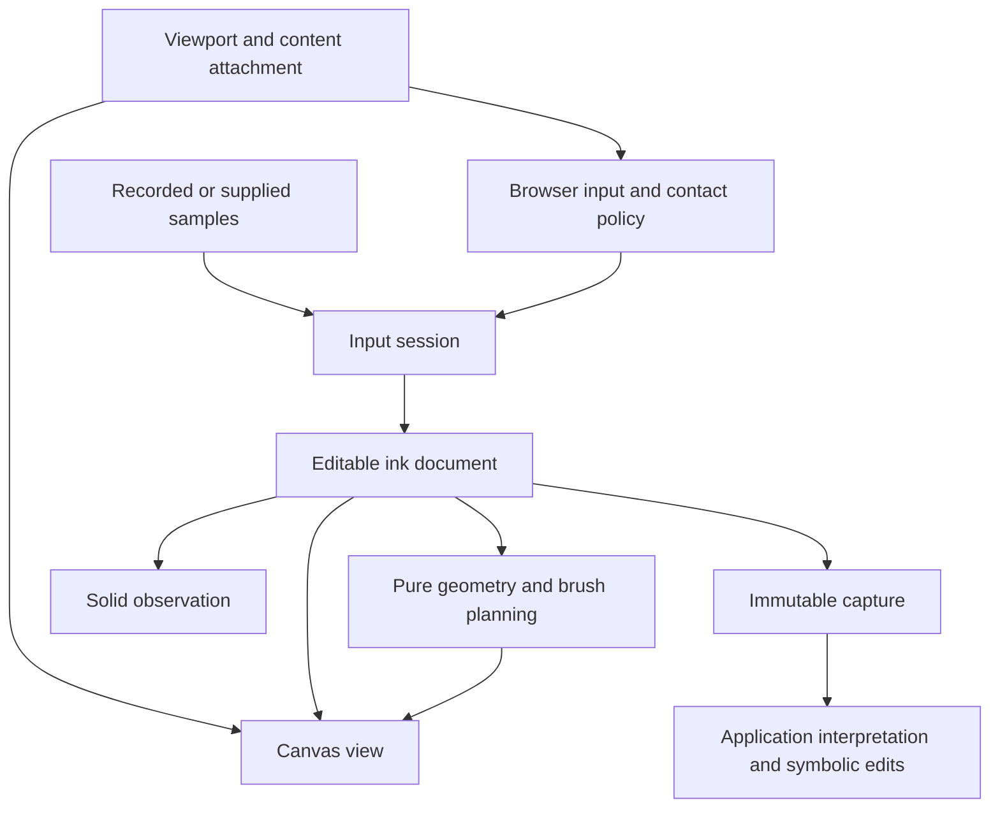

# Pencil architecture

Pencil owns editable stroke input and its presentation. Applications combine ink
with speech, page context, and symbolic documents. Selecting, annotating,
authoring, and correcting are useful evaluation scenarios; none is a mandatory
semantic mode or a classifier built into the API.

## Ownership and public boundaries



| Boundary | Owns |
| --- | --- |
| `core` | Immutable completed records, live buffers, transactions/history, sessions, transforms, geometric queries, and numerical processing |
| `input` | Browser delivery, contact policy, pointer capture, accepted/rejected telemetry, and control guards |
| `canvas` | Disposable canvases/caches, display effects, attachment adapters, and the convenience surface |
| `solid` | Consistent reactive snapshots with a bounded live cadence |
| Application | Speech, grouping, AI interpretation, document edit vocabulary, background capture, and revision UI |

`PencilSurface` composes a document, browser binding, presentation controller, and
Canvas view. Its objects are directly accessible. A document can also be used
without DOM or Solid, and multiple views can display it independently.

## Document and operations

Completed records carry stable IDs, monotonic record revisions, immutable source
samples, copied profiles, start/end times, placement transforms, and erasure
coverage. Live samples accumulate in session-owned drafts. Finishing input commits
one transaction; cancellation creates no history entry. Undo/redo restores IDs
with fresh revisions. Unchanged records retain object identity.

`begin`, `append`, `finish`, and `cancel` are mechanical input operations.
`setParams`, `setTransform`, `remove`, `clear`, and `import` edit completed records.
History is bounded by transaction count, independently of cached pixel memory.
`discard` removes working records and creates a history barrier so expired data
cannot accidentally return through undo. It leaves live drafts intact.

`createInkSession` namespaces incoming IDs and cancels only its drafts at disposal.
Programmatic input enters the same document boundary as browser input. Transport
and pairing are external concerns. Samples supplied by another device need an
agreed ink coordinate system and normalized timing.

Each operation publishes a coherent post-operation snapshot and a mechanical
change kind. Reentrant edits are queued for notification in revision order.
Painting, displaying a capture, and moving a viewport create no new input events.

## Erasure and geometry

Whole-stroke erase removes target records. Partial erase stores a swept circular
footprint against target strokes, in their local coordinates. Radius is the
selected eraser `size`, independent of brush opacity and grain. Target IDs and
revisions are captured at eraser-down; later or concurrently changed records are
unaffected. Preview and commit use the same coverage model, and cancelling a
preview restores the unchanged document.

Masks move with a stroke's placement. Undo removes the erasure edit; rebuilding
all pixels from data reproduces the same cuts. The renderer subtracts mask
coverage from each target layer before compositing. The CPU hit query samples
painted dab footprints at a documented tolerance, including existing erasure;
it is a geometric query, not a test of individual paper-grain pixels.

The numerical pipeline is independent of rendering:

```text
samples → filter → corners → interpolated centerline
                              ├→ measurements / resampling
                              └→ brush planning → dabs → pixels
```

`processStrokeGeometry` accepts geometry parameters. `planBrush` adds appearance;
`planStroke` composes them and retains intermediate stages for inspection.
`WRITE` and `SKETCH` are parameter presets, not interpretations of user intent.
The live renderer uses batch processing as its reference. `earliestChangedDab`
compares actual plans for experiments with incremental rendering; no fixed-tail
heuristic determines which geometry is correct.

Source samples, processed centerlines, editable captures, and visible raster
captures are different products. Partial erasure can remove one side of a thick
stroke without crossing its centerline. A consumer needing exact visible
polygons must perform outline construction and coverage subtraction; that
optional numerical adapter is not supplied. Proximity, coverage, and polygon-area
queries provide ingredients for selection without selecting or deleting anything.

Run `pnpm exec tsx packages/aiui-pencil/lab/benchmark-geometry.ts` to measure
synthetic 120 Hz stroke prefixes. The initial Node CPU run measured approximately
0.5 ms for a 600-sample full plan and 2.2 ms for 2,400 samples. These are local
computational observations, not iPad latency or browser raster benchmarks.

## Coordinates and input

Browser client coordinates map into ink coordinates; a viewport maps ink into
view coordinates, followed by device-pixel-ratio scaling. The built-in transform
is translation, positive uniform scale, and clockwise rotation in radians.
The browser binding maps positions and brush azimuth into ink coordinates;
pressure, contact sizes, and timestamps retain their sensor values. An
intentional placement edit is separate from view navigation.

Resizing, panning, zooming, or rotating a view preserves stroke IDs, samples,
history, and times. Clipping uses all four inverse-transformed viewport corners;
ink that leaves the screen can be reconstructed when it returns.
Scroll attachment is an explicit mapping supplied by the application; arbitrary
DOM reflow has no universal transform. The attachment adapter can hide and
invalidate an overlay while retaining its ink, then resume after the caller
supplies a meaningful mapping. A coordinate ownership change cancels active
local contacts rather than joining incompatible frames.

The pure contact policy handles pen priority, provisional finger cancellation,
palm rejection, navigation eligibility, and cooldowns. The browser binding owns
listeners and pointer capture. Automatic pen latching or explicit pen enablement,
finger drawing, and navigation are configurable. `onSamples` distinguishes
observed input from accepted ink; predictions are diagnostic only.

Control guards share pen activity with the drawing binding and can cover
surrounding application controls. A rejected touch remains rejected through its
release and trailing click. No full-screen event shield is required.

In Pencil mode, the surface applies two-finger pan, zoom, and rotation by default.
Each operation can be disabled; zoom has explicit limits. A gesture supplies its
previous/current centroid, scale ratio, and shortest angular delta. This keeps
the content under the fingers fixed while zooming or rotating. Applications use
`onViewportChange` to apply the same transform to underlying content.

Navigation waits while the pen is down. Contacts present during writing stay
ineligible until lifted; fresh fingers can navigate immediately after pen-up.
Additional contacts cannot change the active finger pair abruptly. Outside
control guards retain their own cooldown. The `palmContactPx` size heuristic is
opt-in: contact dimensions are measurements, not a palm classification.
For example, [WebKit derives pointer width and height from touch radii](https://github.com/WebKit/WebKit/blob/main/Source/WebCore/dom/ios/PointerEventIOS.cpp).
The default uses pen activity and contact lifetime so a large reported finger
does not silently disable navigation.
Native browser navigation and application navigation must be chosen deliberately:
pointer cancellation does not override the browser's
[`touch-action` contract](https://www.w3.org/TR/pointerevents3/#declaring-direct-manipulation-behavior).

## Rendering and fading

A Canvas view owns its observers, backing store, frame scheduling, geometry
cache, and bounded pixel cache. Cache eviction never limits undo. Pixel tiles
are clipped to the visible area. Static views stop scheduling frames; inactive
views release their frame work. Geometry can be invalidated independently of
source data.

Paper grain is deterministic. Views render brush geometry and masks in ink
coordinates before applying the viewport. Cached plans follow samples/profiles;
pixel caches also account for coverage, display style, placement, density, and
visible bounds.

`InkPresentation` owns appearance clocks independently of the renderer. It
supports crossfade and hold/charge/pop. During the pop, ink spreads and opens
through the middle before disappearing. The opening is subtracted from the
whole displayed stroke, so overlapping dabs cannot refill it. Fading retains
source records by default.
Fade completion is recorded independently of painting, including for inactive
views. Changing timing or curves does not reveal a record revision that has
finished fading. Captures render retained ink independently of this display state.
Optional expiry removes working records through a timer even without an active renderer;
expiry creates a working-history barrier. Immutable captures remain valid.

A requested exit is tied to captured record revisions. `fadeCompleted` animates
completed ink while preserving new/live input. Editing a captured record prevents
that request from discarding the changed record. `dispose` cancels presentation
timers and subscriptions.

## Reactive observation and development

`inkSignals` publishes one coherent snapshot. Growing drafts publish cumulative
samples at a configurable rate; snapshot production is throttled as well as signal
updates. Commits, cancellation, edits, undo/redo, and clear publish without waiting
for that throttle. Disposal cancels pending work. A changed erasure/profile
revision is observable even when the source sample array remains unchanged.

The lab reads accepted drafts from the document for diagnostics and uses the
browser input hook for telemetry. Parameter changes update profiles directly;
rendering and numerical diagnostics consume the same records. Controls and
actions are scoped and available to agents. The capture fixture displays its
original image beside a deterministic sample result, then retires only unchanged
submitted records. It makes no AI request and imposes no intent mode.

The lab also places fixed transparent ink above a scrollable DOM reference page.
Linking the two views applies one translation/scale/rotation mapping to both;
unlinking them exposes independent movement. The scene coordinator keeps
synchronous browser-event state and publishes snapshots to reactive controls.
Changing the reference page's width causes actual text/card reflow and pauses
existing ink until explicitly resumed. This demonstrates the boundary between
view movement with a known mapping and content edits requiring application judgment.

Application scopes own durable documents and captures. Components adopt views;
disposable cell graphs derive measurements and analysis. Recreating a renderer
from the same document replaces its algorithm closures and caches while
preserving ink. A scoped runtime slot disposes the previous input, observation,
and rendering objects before installing replacements. HMR disposal also releases
them; replacement does not depend on that callback being invoked for a transitive
dependency. Application mount points use `PageBoundary`, and imperative crossings
use bridge helpers.

## Capture and interpretation

`document.capture()` freezes completed strokes and their revisions. Rendering a
capture uses its recorded profiles, transforms, and erasures, independently of
subsequent edits and display fading. Keep the submitted image as evidence if
future algorithm changes should not alter what was originally sent to an AI.

The application collects audio/transcript and symbolic/background context,
coordinates their layout with the ink capture, and decides when to submit.
An answer may edit nothing. If it applies a structured edit, it validates that
operation in its own document model. `document.retire(capture)` removes only
records still at the submitted revisions, preserving newer/changed ink.

A stroke ending does not imply submission. Grouping, inserting, appending,
revising symbolic content, and reviewing original evidence are application
operations. A capture plus context supports all of them.

## Verification

Unit tests cover numerical geometry, contact policy, document transactions,
capture independence, notifications, reactive cadence/disposal, and fading.
Browser tests exercise actual Canvas coverage, cache eviction, multiple views,
scroll attachment and invalidation, capture rendering and review, idle scheduling,
the lab, and Circle. A controlled source update verifies that hot reload preserves
completed records, disposes the previous view, and accepts new input.

Synthetic browser input establishes event-policy behavior, not Apple Pencil
pressure quality or palm recognition on hardware. Use the lab on iPad to assess
real contact delivery, writing latency, and navigation feel. Optional outline
conversion and concurrent pen/navigation are bounded experiments; they do not
require changes to the document or semantic modes.

## Hardware input and Wacom compatibility

The living [Wacom browser input note](./wacom-browser-input.md) records the
Movink 13 hardware observations, representative browser traces, current
compatibility behavior, validation status, and proposed input refactor. Keep new
hardware findings there so users and future agents share one evidence record.

Capture loss alone no longer cancels a stroke: input remains active until
pointer-up or a real cancellation, including when release occurs outside the
canvas. Unit and browser regressions cover this ordering.

The lab now handles Ctrl+wheel pinch and allows an ambiguous mouse draft to
yield to it while preserving observed pen pressure/tilt evidence. These wheel
rules are lab-specific; they do not yet form a unified library policy with
pointer-based navigation. Ordinary wheel protection, committed stray marks,
rotation delivery, and diagnostic geometry performance remain open. See the
note before extending device detection or changing stroke ownership.
