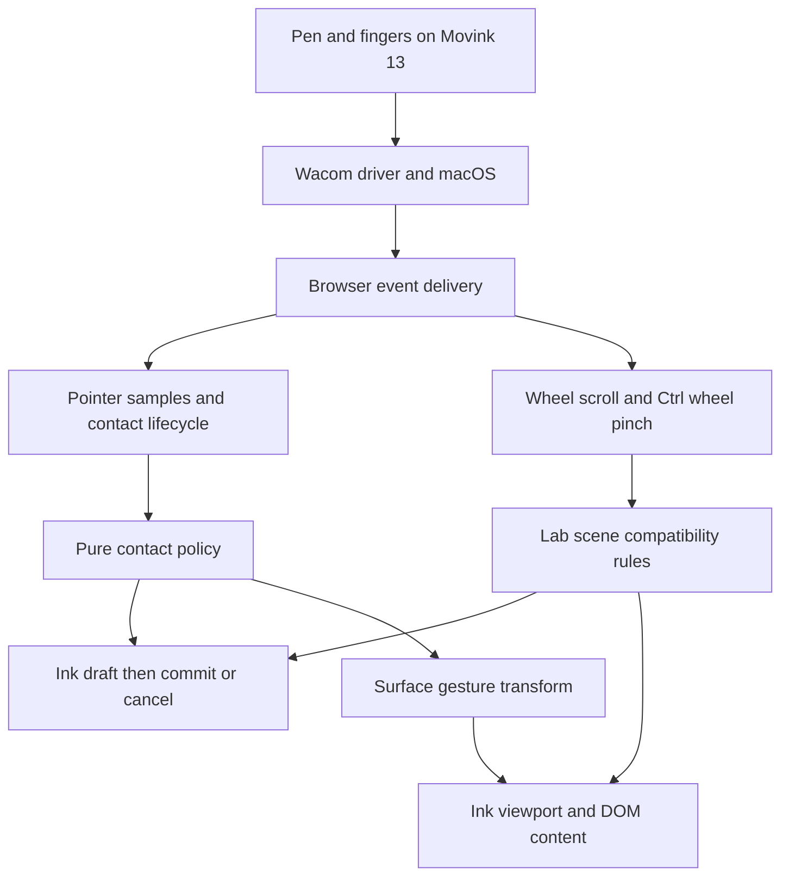

# Wacom tablet input in the browser

The Movink 13 currently provides usable pen drawing and canvas pinch zoom in the
tested macOS Chromium setup. Touch navigation is only partly understood. A finger
can arrive as a mouse pointer, and a real pen can also arrive labelled as mouse.
The browser does not expose the individual finger contacts or rotation angle in
the traces collected so far.

The immediate objective is a working drawing surface without adding a gesture
recognition delay to pen strokes. The later objective is an input architecture
whose decisions can be explained and tested against actual device data. The
current compatibility rules are a starting point for that work, not a general
Wacom device classifier.

Last updated: **2026-10-17**. This is the living hardware evidence and refactor
note for Pencil. [Architecture](./architecture.md) describes the current library
boundaries. [Recorded excerpts](./evidence/movink13-2026-10-17.json) preserve the
measurements behind the conclusions below.

## Scope and evidence

| Item | Tested setup |
| --- | --- |
| Hardware | Wacom Movink 13, DTH135, with Pro Pen 3 |
| Host | macOS; exact OS build was not recorded with these captures |
| Browser | Connected Chromium browser; reported user agent contains Chrome/155.0.0.0 |
| App | Pencil Lab, local development server |
| Base checkout | `bd109ebb`, plus the uncommitted lab compatibility changes from this session |
| Wacom settings inspected | Touch on; Scroll, Zoom, and Rotate enabled; Basic gestures showed no separate one-finger click/drag switch |
| Driver | User had reset the driver before this round, resolving many earlier failures; exact version was not reverified for these captures |
| Browser capability probes | `maxTouchPoints = 0`; no `ontouchstart` or `ongesturestart` property; device pixel ratio 1.75 |

The user agent's macOS and CPU strings are not a measurement of the actual OS
build or processor. Capability probes describe this browser session; they do not
show that the tablet lacks touch hardware.

Physical action labels come from the user's isolated tests. Event fields and
document outcomes come from passive browser observers and the live application.
The capture did not inspect native driver events, so it cannot locate exactly
where device identity or gesture information was lost.

The JSON contains selected excerpts, not complete replay fixtures. Missing fields
mean “not recorded.” Original collector timestamps are retained; they are not
hardware-to-display latency measurements. HMR recreated input bindings and reset
their counters while preserving the ink document, and the user sometimes cleared
the drawing. Compare each test with its own baseline.

## What reached JavaScript

| Physical action | Observed delivery | Implication |
| --- | --- | --- |
| Normal pen writing | Usually `pointerType: "pen"`, varying pressure and tilt | The normal pen path works, including light and quick strokes. |
| Some real pen strokes | `pointerType: "mouse"`, with varying pressure and/or tilt | Rejecting every mouse pointer would reject real pen input. |
| Isolated one-finger drag | One mouse pointer; pressure 0.5 while pressed, 0 on lift; tilt 0; width/height 1; no touch events | These fields did not distinguish the finger from an ordinary mouse. |
| Finger pinch | `wheel` with `ctrlKey: true`, pixel deltas | Can drive application zoom, but supplies no pair of finger positions. |
| Finger navigation and pan | Ordinary wheel events, sometimes before pinch events | A single physical interaction can move between scrolling and zooming. |
| Isolated two-finger twist | Two mouse down/up sequences; no wheel, touch, or gesture event with an angle | The current browser path supplied nothing from which to compute rotation. |
| Pen release | `lostpointercapture` sometimes precedes `pointerup`, including release outside the canvas | Capture loss is not itself stroke cancellation. |

The mouse-labelled finger records had `sourceCapabilities?.firesTouchEvents`
recorded as null. That supplied no additional classification signal.

Pointer Events defines mouse, pen, and touch types, and pressure normalized to
0–1. A platform without pressure information uses 0.5 while pressed and 0
otherwise. Thus 0.5 is not evidence that a contact is a finger, and a nonzero
pressure value alone does not establish that it is a pen.
[Pointer Events specification](https://www.w3.org/TR/pointerevents3/#pointerevent-interface)

This is about the fields on **PointerEvent** records. It is not merely the
browser also emitting legacy `mousedown` events alongside correctly typed pen
events.

### Representative observations

Three quick strokes that the user drew with the pen began with:

| Reported pointer type | Initial pressure |
| --- | --- |
| mouse | 0.501960813999176 |
| mouse | 0.5333333611488342 |
| mouse | 0.5411764979362488 |

Before the zoom fix, an isolated pinch delivered 216 Ctrl+wheel events. Browser
visual viewport scale reached about 2.74 while ink scale stayed at 1. That was
browser page magnification, not a change to the ink transform.

During the later direct handoff, the observers recorded:

| Collector time in ms | Record |
| --- | --- |
| 10009230.900 | Mouse pointer down, pressure 0.5, zero tilt |
| 10009310.700 | The associated ink draft was cancelled |
| 10009312.800 | Window observer received the first Ctrl+wheel event, already prevented, with no active draft |
| 10010725.900 | Mouse pointer up; no stroke committed |

The cancellation appears before the wheel observer because the canvas handler
runs before that window bubble listener. It does not mean cancellation preceded
the originating wheel event. The JSON retains the original precision.

## The current data path

Only the browser side of the driver/browser boundary was observed. The separate
pointer and wheel branches are important: the contact policy's touch-pair logic
never receives the finger pair from these Wacom traces.

Wacom describes native macOS delivery through NSEvent, including mouse events
with tablet subtype data and additional pressure/tilt information. Native mouse
events with tablet data are not equivalent to DOM mouse-labelled PointerEvents;
the browser performs another translation. This explains why the native and web
boundaries need separate investigation, but does not establish which component
caused the inconsistent labels here.
[Wacom macOS event delivery](https://developer-docs.wacom.com/docs/icbt/macos/ns-events/ns-events-basics/)

| Source | Current responsibility |
| --- | --- |
| [telemetry.ts](../src/telemetry.ts) | Normalize pressure and orientation into `PenSample`; report what fields were supplied |
| [input/pointer.ts](../src/input/pointer.ts) | Event listeners, capture lifetime, coalesced samples, contact decisions, sink delivery |
| [input/policy.ts](../src/input/policy.ts) | Pure contact ownership, pen priority, provisional touch drawing, touch-pair navigation |
| [surface.ts](../src/surface.ts) | Compose input, document and view; map coordinates; apply navigation |
| [scene.ts](../lab/src/model/scene.ts) | Lab DOM scrolling, content mapping and Ctrl+wheel zoom |
| [wheel-navigation.ts](../lab/src/model/wheel-navigation.ts) | Decide whether an ambiguous local mouse draft may yield to pinch |
| [store.ts](../lab/src/model/store.ts) | Lab controls, runtime ownership and observed/accepted sample telemetry |
| [graph.ts](../lab/src/model/graph.ts) | Reactive geometry and diagnostic computations |

Raw browser fields and normalized samples are different evidence. Stored
`PenSample` positions and azimuth have already been mapped into ink coordinates.
An upright mouse's stored azimuth can change with view rotation; it is not a
reliable raw tilt clue. The compatibility predicate checks altitude, not azimuth.

The lab's touch readout and `input.counts().zooms/scrolls/rotations` describe the
pointer contact policy. Wheel navigation bypasses those counters. “Waiting for
fingers” or a zero zoom count therefore does not establish that no navigation
occurred.

## Working behavior and its limits

### Stroke lifetime

The earlier disappearing-stroke bug treated capture loss as cancellation. The
binding now retains a contact until actual pointer-up or cancellation, with
document capture listeners continuing an active pointer outside the canvas.
Blur, disabling input and disposal can still cancel a draft.

Resetting the Wacom driver also resolved an episode in which the browser received
no pen events. Keep that delivery failure separate from the application
discarding a stroke it had already received.

### Canvas pinch zoom

The lab owns Ctrl+wheel over its canvas with a non-passive wheel listener.
It prevents browser zoom, normalizes wheel units, and changes the view around the
event's client position. Scale stays within 0.1–10, and linked DOM content follows
the ink. Navigation and zoom controls gate the operation.

This is currently **lab behavior**, not a general wheel adapter implemented by
every `PencilSurface` consumer. The canvas event position is the anchor; no
measured two-finger centroid is available.

### Provisional mouse ink yielding to pinch

A first finger can start a mouse-like draft before the driver recognizes pinch.
The initial zoom fix protected every active draft, which blocked 32 pinch events
in one test. The revised rule permits a local draft to yield only if every
recorded point is mouse-labelled, pressure is 0 or 0.5, altitude is upright, and
barrel rotation is zero.

A delivered pinch cancels that contact and its draft before navigating. Later
move/up cannot resurrect the mark. A pen-labelled sample, nondefault pressure,
tilt, or barrel evidence anywhere in the draft protects it. No waiting period
was added to the pointer drawing path.

This is a gesture ownership rule, not proof that the contact was a finger.
A genuine mouse drawing yields to Ctrl+wheel too. An upright pen mislabelled
mouse with only default pressure is still ambiguous. A brief preview can appear
before navigation is recognized, and a mark already committed before the first
wheel event is not retrospectively removed.

### Wacom settings and native access

Wacom documents individual basic gesture switches on macOS. The relevant
switches were already on in the inspected Movink settings.
[Basic gestures](https://101.wacom.com/userhelp/en/TouchGesturesBasic_Full.htm)

Selective touch limits input to Wacom's on-screen shortcuts; it does not preserve
ordinary canvas navigation.
[Movink 13 touch setup](https://101.wacom.com/userhelp/en/TouchGesturesSetup_DTH135.htm)

Wacom documents a native macOS multi-touch framework for raw finger data.
That is a possible separate integration route, not a browser JavaScript option
established by these tests. No native bridge was built.
[Wacom native multi-touch API](https://developer-docs.wacom.com/docs/icbt/macos/multi-touch/multitouch-framework-basics/)

## Validation record

These are individual checks, not a declaration that all Wacom interaction works.

| Check | Outcome and evidence |
| --- | --- |
| Mouse and slow pen baseline | Three of each remained, no stranded drafts; capture loss before pen-up was observed. |
| Quick strokes with varied pressure | 25 additional strokes remained, including 23 reported as pen and two as mouse; no cancellations in that phase. |
| Release outside canvas | Four additional strokes remained; two pen releases targeted the header outside the canvas. |
| Focus interruption | One cancellation, then successful drawing. The isolated test recorded no window blur, so it did not establish the exact native focus sequence. User accepted Command-Tab retaining the stroke when focus remained. |
| Canvas zoom replacing page zoom | 428 recorded Ctrl+wheel events prevented; ink scale reached about 2.28 and page scale remained 1. One extra stroke meant stray marks were still open. |
| Pen placement after zoom | User confirmed placement and retained alignment; reported finger navigation still flaky. |
| Staggered fingers with mixed navigation | Two drafts cancelled, no committed marks or stranded draft; 116 pinch and 124 ordinary wheel events. Both cancellations followed ordinary scroll before pinch. |
| Pen recovery and direct pinch handoff | Latest run: nine pen-labelled strokes committed, one mouse-like draft cancelled at the first Ctrl+wheel event, no stranded draft; 409 pinch and 128 ordinary wheel events; page scale stayed 1. User reported success. |
| Rotation gesture | No usable rotation signal in the isolated test. Open. |

The selected excerpts are organized under the same scenarios in the
[evidence JSON](./evidence/movink13-2026-10-17.json). Lifetime counters include
earlier phases; the latest recovery phase itself had nine commits and one
cancellation.

Automated checks after the handoff change: 245 unit tests, three selected
Chromium regressions, package/lab typecheck, and lint passed. The browser checks
cover capture loss, actual browser-delivered touch navigation, and Ctrl+wheel
with pen protection and mouse-draft cancellation. They establish application
behavior for supplied events, not Wacom driver behavior or measured pen latency.

## Gaps to resolve before calling navigation robust

1. **Ordinary wheel and pinch use different ownership rules.** Ordinary wheel
   scroll still moves the scene and can reach `paper.setViewport()`, which
   cancels active local input. It has no equivalent pen-evidence guard. Mixed
   gesture cleanup exercised this path; simultaneous scroll during real pen
   writing still needs explicit protection and testing.
2. **Pen priority still relies on reported pointer kind in the contact policy.**
   A pen labelled mouse can be protected by the lab's pinch predicate yet remain
   unrecognized as pen activity by other policies and surrounding control guards.
3. **Completed stray marks remain.** Mouse-up before pinch commits a stroke.
   Automatically deleting the latest stroke would risk deleting intentional ink;
   ownership needs stronger evidence than recency.
4. **Gesture transitions need measurement.** Scroll, pinch and pointer events
   can interleave. Wheel position may not equal the physical finger centroid.
   Keep event ordering and view changes together when investigating jumps.
5. **Rotation needs an input source or a deliberate alternative.** The existing
   Rotate left/right controls can exercise view rotation, but do not constitute
   working Wacom twist support. Another browser, driver configuration or native
   adapter is an experiment, not a promised solution.
6. **Capability and activity diagnostics are incomplete.** Touch-only counters
   hide wheel navigation. Raw delivery, ownership decisions and resulting view
   changes need distinct, correlated records.
7. **Performance is separate.** `HOT_SCOPE_TIME` warns that a reactive memo used
   more than its 8 ms budget over a 1000 ms window; it does not identify a single
   8 ms frame or prove why a stroke disappeared. `plans` recomputes completed
   geometry from `ink.strokes()`; `inkStats` also plans the newest stroke for
   area. Both accessors share the snapshot signal. Profile invalidation and
   geometry work before changing throttles or assuming latency is fixed.

## Proposed refactor

The following is a direction for later work, not an implemented API.

1. **Capture delivery without classifying it away.** Preserve reported pointer
   type, raw pressure/orientation, event phase, modifiers, capture state and
   source channel. Keep raw client coordinates distinct from normalized ink
   coordinates. Record unknown values as unknown.
2. **Adapt delivery channels into one interaction policy.** Native touch pairs,
   wheel gestures and pointer streams should feed a shared pure reducer. Its
   outputs should be explicit: begin/append/commit/cancel ink, or navigate a
   view. Keep DOM listeners and viewport application outside that reducer.
3. **Represent evidence separately from ownership.** “Reported mouse,”
   “contains pen pressure/tilt evidence,” and “currently owns ink” are different
   facts. Retain evidence across the contact lifetime. Do not turn the current
   0/0.5 compatibility rule into a universal device identity test.
4. **Make ambiguity a documented policy choice.** A Wacom-oriented profile may
   prefer navigation over ambiguous mouse drawing once a gesture begins. A
   mouse-drawing profile may choose differently. Both must preserve immediate
   pen input; strict pen-only mode cannot simply reject all reported mouse
   input on the evidence collected here.
5. **Unify navigation application.** Pan, pinch and rotation should share
   enablement, active-ink protection, coordinate ownership, limits, cancellation
   and telemetry. Keep external view changes distinct from owned gestures so a
   routine gesture does not accidentally invoke destructive contact reset.
6. **Replay before generalizing.** Capture complete event streams for each
   known sequence, then test the pure policy and browser integration. The
   current JSON excerpts are source evidence for those cases, not complete
   fixtures. Compare hardware behavior after each policy change.

Preserve these invariants: no timer before a pen stroke begins; accepted real
samples remain intact; predictions never become committed input; capture loss
alone never discards ink; a cancelled provisional contact cannot later commit;
view transforms do not rewrite source samples. Heavy diagnostics and reactive
geometry work must not become part of the synchronous pen handling path.

## Keeping the evidence current

For each new experiment:

1. Record device, actual OS/browser/driver versions, relevant driver settings,
   code revision and input policy. Mark a new phase before the physical action.
2. Give the user one isolated action. Record their description separately from
   the browser's reported pointer type.
3. Capture pointer down/move/up/cancel and capture gain/loss; wheel deltas,
   units, modifiers and position; available touch/gesture events; blur,
   visibility and viewport changes. Capture raw pen fields and coalesced and
   predicted sample counts. Retain capture-phase event data and post-handler
   prevention state without confusing their callback ordering.
4. Correlate document begin/finish/cancel and navigation decisions with the raw
   stream. Include reason, contact/stroke identity, source and destination view,
   completed/draft counts, and baseline counters. Record clear, undo and runtime
   replacement so count changes are explainable.
5. Use bounded passive recording and summarize after the gesture. Avoid console
   output on every move. Disable diagnostic recording when measuring latency,
   and record any dropped events when a buffer fills.
6. Save a scoped trace beside this note, update the observation and validation
   tables, and turn each resolved failure into a focused regression. Keep
   hypotheses and untested alternatives out of the “observed” column.

The temporary `window.__pencil*` observers used in this session are not a
supported recorder API and can hold stale runtime references after HMR. Future
work should add a small explicit capture/export facility rather than depending
on those globals. The existing `onSamples` hook is useful for normalized
accepted/rejected samples, but does not capture raw wheel delivery or every
lifecycle event.

Next implementation priority: unify ordinary-wheel and pinch ownership/protection,
then collect and replay mixed gesture transitions. Continue documenting the
working compatibility behavior while that refactor is developed.
