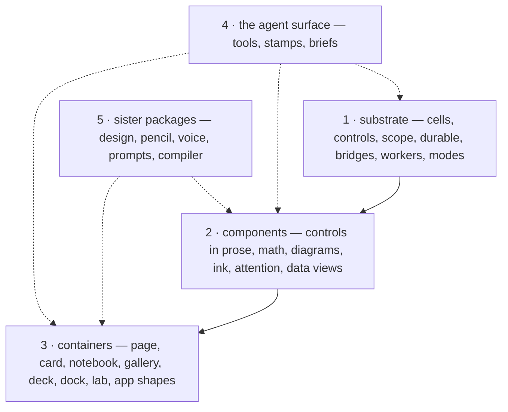

# The catalog: what aiui-viz provides

Status: reference, 2026-10-16. Kept by hand — when a piece lands, changes state, or is retired,
this page changes in the same commit.

This is the one page that names every piece the package provides — the **substrate** everything
is built from, the **components** a page is written with, the **containers** that hold pages and
components, and the **agent surface** that crosses all three — with where each lives, what state
it is in, and where it is used. The sister packages that happen to share this repo are listed at
the end so the catalog is complete. Read this first. The [README](./README.md) is the export-level
detail of the substrate, the [concepts page](./docs/frontend-for-agents.md) explains how the pieces
work and why, and the [style guide](./docs/frontend-style-guide.md) says how a page should use
them. The application-level inventory (capabilities across the planned applications, `C01`–`C13`)
is §6 of the [three-applications proposal](../../docs/proposals/three-applications-and-development-process.md);
this catalog is the library-level one it asks for. [`demos/catalog`](../../demos/catalog) renders this
file as a gallery page with the pieces shown live; it is a sheet, not evidence — a row's state comes
from the notebooks and labs named in it.

## How to read an entry

Every row carries the same five things:

| Column | Meaning |
| --- | --- |
| **Piece** | The name you import, or the package you install. |
| **What it is** | One or two sentences in the terms a page author would use. |
| **Where** | The import path (`…` stands for `@habemus-papadum/aiui-viz`) and the source file, or the package. |
| **State** | `shipped` — used by a demo or a sister package. `spike` — in the library with tests and a lab page; no notebook uses it yet. `proposed` — a design document only. |
| **Seen in** | The demo, lab page or package that proves it. |

The shape, in one picture:

## 1. The substrate

What every component and container is built from: dataflow, identity, durability, and the
crossings into imperative code. Read: the [README](./README.md) table for each export's contract,
the [user guide](./docs/frontend-user-guide.md) to learn them in order, the
[playbook](./docs/frontend-playbook.md) for the order of building.

| Piece | What it is | Where | State | Seen in |
| --- | --- | --- | --- | --- |
| `cell`, `cellGraph`, `cellRegistry`, `settledOnly` | Observable-style async dataflow cells: seven states, an `AbortSignal` per run, progress, a last-good value that survives errors. | `…` · `src/cell.ts` | shipped | every demo |
| `durable`, `durableSignal`, `hotCellGraph`, `adopt`, `durableCanvas` | The durable/disposable line: resources that outlive a hot reload, and the graph that is rebuilt over them on every edit. | `…` · `src/durable.ts`, `src/hot-graph.ts`, `src/adopt.ts` | shipped | every demo |
| `viewportWidth`, `elementWidth`, `now` — the resize seam | The page's reactive dimensions and clock ([viewport.md](./docs/viewport.md)): the layout viewport's width and height, an element's content box over one shared ResizeObserver, and `now()` ticking per animation frame only while something reads it. Plain signals in the durable registry: one listener per document across hot reloads, nothing the `report` tool sees. | `…` · `src/viewport.ts` | shipped | `PlotFigure` fills its host with it — every Plot figure in morphogen, aztec, the catalog, the lab |
| `control`, `action`, `controlSurface` | The control surface: curated, validated, durable knobs and named verbs. Names, sites and descriptions are injected by the compiler; declaring is exposing. | `…` · `src/control.ts` | shipped | every demo |
| `scope`, and the source stamps | Instance identity for reusable slices (`left/freq`), plus the compile-time names and source locators that [`aiui-source-processor`](../aiui-source-processor/README.md) injects. | `…` · `src/scope.ts` | shipped | [`demos/twins`](../../demos/twins) |
| `bridgeEffect`, `throttled`, `dependencyEdges` | The crossings into imperative islands (WebGL, canvas, audio): a hardened effect whose throw is recorded rather than fatal, an outbound rate valve, and the live control→cell edges. | `…` · `src/bridge-effect.ts`, `src/throttle.ts`, `src/graph-trace.ts` | shipped | morphogen, circle, audio |
| `workerStream`, `fromWorker` | A cancellable request/stream protocol that turns a Web Worker into an async generator a cell consumes. | `…` · `src/worker-stream.ts` | shipped | aztec, gratings, holograms |
| the modal kit, `solidModeEngine` | Modes as data with a mechanical Esc ladder, keymap layers whose claim-or-pass is exhaustive, guarded async effects, a bar projection, a reconciler that asserts surface invariants. | `…/modal` · `src/modal/`; `src/mode-solid.ts` | shipped | aiui-slides, walkthrough, aiui-audio |
| `ensureAiuiGlobal` | `window.__AIUI__`: the shared tool registry, `selection()`, `sources` — installed by the runtime, in dev and in production, with no plugin. | `…` · `src/aiui-global.ts` | shipped | every page |
| vendor keys | Origin-wide vendor keys; a pasted key wins over the dev server's seed; nothing here sends one. | `…/vendor-keys` | shipped | aiui-dock, aiui-live |
| the testing harness | `cellHarness`, `whenReady`, `whenState`, `recordCommits`, `resetControlSurface` — build a graph under a disposable owner and await its states. | `…/testing` | shipped | the package tests, aiui-slides, aiui-oracle |

## 2. Components

The visible pieces a page is written with. The common thread: **a piece stays addressable after
something has drawn it** — a number in a sentence, a term in an equation, a node in a diagram, a
stroke on a canvas — so it can be styled, hovered, clicked, annotated, dragged, and read back by
an agent.

### 2.1 Controls and cells in the prose and the chrome

Read: the [README](./README.md) rows; the [style guide](./docs/frontend-style-guide.md).

| Piece | What it is | Where | State | Seen in |
| --- | --- | --- | --- | --- |
| `ControlSlider`, `ControlToggle`, `ControlSelect` | Widgets bound to a declared control: bounds, step, unit and options come from the declaration, the root carries `data-control`, the description is the tooltip. Deliberately not an auto-panel. | `…` · `src/control-widgets.tsx` | shipped | most demos; the select in styleguide and the pencil lab |
| `ControlScrub` — the scrub pill | A number in the prose you press and drag sideways; a fixed drag length crosses the declared range, `log` for decades. The design system's one sanctioned pill, "because it is an instrument, not a button". | `…` · `src/control-widgets.tsx` | shipped | styleguide; skinned in aiui-design |
| `CellView` | The notebook wrapper: spinner and progress before the first value, an error box with retry, and the last render kept (dimmed, with a progress stripe) while a new run streams. | `…` · `src/cell-view.tsx` | shipped | every demo |
| `CellText` | A cell's value as quiet prose inside a sentence, with the same `data-cell` stamps. | `…` · `src/cell-text.tsx` | shipped | styleguide |
| `Dropdown` | A refresh-aware dropdown: every open fires `onOpen`, so a list is current at the moment it is looked at. Unstyled beyond geometry. | `…` · `src/dropdown.tsx` | shipped | no in-repo consumer |

### 2.2 Mathematics

Read: [style guide § Mathematics](./docs/frontend-style-guide.md); the header of
[`src/site/rich-tex.tsx`](./src/site/rich-tex.tsx).

| Piece | What it is | Where | State | Seen in |
| --- | --- | --- | --- | --- |
| `TeX` | One TeX string, rendered by KaTeX as one block and stamped `data-tex`, so `read-page` and `selection` give the equation back as TeX. | `…/site` · `src/site/tex.tsx` | shipped | morphogen, aztec, seismos, gratings, holograms, circle |
| `RichTeX`, `Term` | An equation built from pieces. Each `<Term>` stays addressable after KaTeX draws it (through `\htmlData`, which changes no layout — pinned by test): colored, classed, marked active, hovered, clicked, annotated with a `note`, or dragged as a knob when bound to a `control`. Copy and the `selection` tool resolve to the covered terms. | `…/site`, `…/site/rich-tex` · `src/site/rich-tex.tsx`, `src/math-selection.ts` | spike | the lab: `/fidelity`, `/training`, `/derivation`, `/fourier` |

### 2.3 Diagrams

Read: [rich-mermaid.md](../../docs/proposals/rich-mermaid.md) (the measured facts and the design);
[semantic-svg.md](../../docs/proposals/semantic-svg.md) (the direction).

| Piece | What it is | Where | State | Seen in |
| --- | --- | --- | --- | --- |
| `Mermaid` | A diagram as a control surface. Mermaid renders the text; the component recovers every node, edge and cluster by the id the author wrote (no marker injection), stamps it `data-aiui-id` / `data-aiui-kind`, and offers `onClick`, `onHover` and `marks` by id — color, fill, class, active, a note, a knob — with wide hit areas under edges. A text change re-renders (async, latest wins, the last diagram kept); a mark touches attributes only. | `…/site/mermaid` · `src/site/mermaid.tsx` | spike | the lab: `/pipeline`, `/anatomy` |
| `aiui-svg` | Semantic, reactive SVG: structured documents with expressive symbol families, direct editing with history, motion, pencil integration. The boundary with Mermaid: Mermaid is the text-first, auto-laid-out view; aiui-svg is the geometry you edit. | working package name `aiui-svg` | proposed | — |

### 2.4 Ink

Read: [aiui-pencil's architecture](../aiui-pencil/docs/architecture.md).

| Piece | What it is | Where | State | Seen in |
| --- | --- | --- | --- | --- |
| `PencilSurface`, `inkSignals` | Editable stroke input: immutable stroke records with transactions and history, pressure/tilt input under contact policies, canvas views with fading, and a bounded-rate reactive snapshot of the ink. Interpretation — what the ink means — belongs to the app. The library is framework-free; `./solid` is the signal adapter. | [`@habemus-papadum/aiui-pencil`](../aiui-pencil/README.md) (`./core`, `./input`, `./canvas`, `./solid`) | shipped | [`demos/circle`](../../demos/circle); the pencil lab |

### 2.5 Attention: hover, marks, notes, knobs, the lens

The ways a page draws the eye to one piece or lets the reader drill into it. Today these are four
local implementations that share conventions but not code; the conventions are the contract.

| Piece | What it is | Where | State | Seen in |
| --- | --- | --- | --- | --- |
| `Lens`, `LensLayer` | Levels of detail in three tiers: an inline trigger (a real button), a hover-or-focus peek built from the pure model only, and a click-to-open detail panel living in the page's own reactive graph. | `…/site/lens` (KaTeX-free) · `src/site/lens.tsx` | shipped | gear-talk, styleguide; aiui-slides re-exports it |
| hover and active marks | `Term`: `active`, `color`, `class`, `onHover`. `Mermaid`: `marks[id].active` / `color` / `fill` / `class`, `onHover`. Both set `data-active`; the page's CSS does the rest. | RichTeX, Mermaid | spike | the lab |
| notes | Annotation JSX anchored to a measured box, placed above or below (Mermaid also left or right), with a leader line; RichTeX runs a collision pass that pushes overlapping notes apart. | `Term note=`, `MermaidMark.note` | spike | the lab: `/training`, `/pipeline` |
| knobs | A symbol or node bound to a numeric control: hover for the value, drag sideways to change it, arrow keys when focused; carries `data-control` like every widget. The scrub pill is the same gesture in prose. | `Term control=`, `MermaidMark.control`, `ControlScrub` | spike (the pill is shipped) | the lab: `/training`, `/pipeline` |

One attention layer that the equation, the diagram and the coming SVG all share is the open slot
here — see [§6](#6-adding-a-piece).

### 2.6 Data views

Read: [duckdb-mosaic.md](./docs/duckdb-mosaic.md), [embedding-view.md](./docs/embedding-view.md),
the [README](./README.md) rows for the crossfilter and SQL tools.

| Piece | What it is | Where | State | Seen in |
| --- | --- | --- | --- | --- |
| `PlotFigure` | Observable Plot behind one seam: reactive options in, a figure out. | `…/plot` | shipped | morphogen, aztec, seismos |
| `MosaicView` | The vgplot bridge: a coordinator and a spec in, a DOM island out. Mosaic owns its own reactivity; Solid never reaches inside. | `…/mosaic` | shipped | seismos, wine, motherduck-lab |
| `EmbeddingView` | Embedding Atlas's WebGL point cloud as a Mosaic citizen: same coordinator, same selections, same agent surface. | `…/embedding` | shipped | wine |
| `selectionDim`, `crossfilter`, `selectionViews` + `SelectionViewsBar`, `SelectionInspector` | The control-surface treatment of Mosaic selections: declared dimensions an agent can drive, a crossfilter with clause routing by column, named views saved and restored by mouse or by tool through the same code path, and an inspector showing every clause's provenance and SQL. | `…/mosaic-selection`, `…/crossfilter`, `…/selection-views`, `…/selection-inspector` | shipped | seismos, wine |
| `registerSqlTools`, the runners, the connector | DuckDB-WASM setup, SQL runners over a connection the app hands in, the `sql` and `schema` tools with schema views, and the Mosaic connector that decodes DuckDB's 128-bit integers. | `…/duckdb`, `…/mosaic-connector` | shipped | seismos, wine, motherduck-lab |

### 2.7 Views for what an agent reads and writes

Read: each module's header comment.

| Piece | What it is | Where | State | Seen in |
| --- | --- | --- | --- | --- |
| `ToolLog` | The on-page tool log over `__AIUI__.tools`: the calls, the inventory, the surface as rendered for a model. Opens on `#aiui-tools`. | `…/site/tool-log` | shipped | aiui-dock |
| `JsonView` | An expandable JSON explorer for tool arguments and results; small flat values stay inline. | `…/site/json-view` | shipped | aiui-dock, aiui-oracle, aiui-live |
| `TextView` | Markdown a model read or wrote, rendered with a toggle to the raw text. HTML is escaped, never injected. | `…/site/markdown` | shipped | aiui-dock |
| `PromptRecordView` | A stored prompt record previewed through the prompts inspector, which loads on first use. | `…/site/prompt-record` | shipped | aiui-dock, aiui-oracle, aiui-live, demos/live |

### 2.8 Voice and capture widgets (sister packages)

| Piece | What it is | Where | State | Seen in |
| --- | --- | --- | --- | --- |
| the audio widgets | `AudioControl`, `AudioMeter`, `AudioRoutePicker`, `MicrophonePicker` over one shared audio hub. | [`aiui-audio`](../aiui-audio)`/widgets` | shipped | demos/audio, the dock |
| the capture widgets | `ScreenCaptureControl`, `ScreenCapturePreview`, and `ScreenCaptureTarget`, which declares a capture boundary around an element. | [`aiui-screen-capture`](../aiui-screen-capture)`/widgets` | shipped | demos/screen-capture |
| the voice-engine widgets | Each engine's panels — control, key, parameters; captions, composer, ledger, tasks. | [`aiui-oracle`](../aiui-oracle/README.md)`/widgets`, [`aiui-live`](../aiui-live/README.md)`/widgets` | shipped | the dock |

**The word "widget."** In this repo a widget is a visible piece over a headless engine or a declared
control — porcelain over plumbing. Widgets may mount twice, because they write shared state and
validation guards every write; there is deliberately no generated control panel. Widgets are
components, not containers.

## 3. Containers

What holds pages and components. Read: [style guide § the page is a short paper](./docs/frontend-style-guide.md),
[design choices § the anatomy of a notebook page](./docs/frontend-design-choices.md), the gallery's
[PRINCIPLES.md](../../demos/gallery/PRINCIPLES.md).

| Container | What it holds | Where | State | Seen in |
| --- | --- | --- | --- | --- |
| the page | `SitePage` `{ title, App, activate, deactivate }`: an app as something a shell mounts. The lifecycle is pause-not-destroy — leaving parks loops and keeps durables; returning re-mounts over them. `PageBoundary` wraps each mount, so one crash shows a fault card with a reset and the siblings keep running. `pathname()` / `navigateTo` is the one route signal: a shell routes on the head, a page on its tail. A shell discovers pages by the `aiui.sitePage` marker and the `./page` export. | `…` · `src/site-page.ts`, `src/page-boundary.tsx`; `…/site` · `src/site/path.ts` | shipped | every demo |
| the card | `DemoCard` `{ blurb, Preview }`: the landing card, a live preview built from the pure model only — never the store or the graph — so a landing can mount every card at once. | `…` · `src/site-page.ts`; a demo's `./card` | shipped | the gallery landing |
| the notebook page | The anatomy a page follows — title block and lede, the laboratory first, then observables, theory, experiments — with `SiteNav` (a sidebar that becomes a top bar and drawer on a phone), `TocRail`, and `colorMode`. The skin is `aiui-design/site.css`, in layers (reset < base < chrome < components < notebook); a page's own unlayered CSS wins over it. | `…/site`; [`aiui-design`](../aiui-design/README.md) | shipped | every notebook |
| the gallery | Many pages, one document. A Vite plugin discovers `demos/*` by the marker and serves `virtual:demo-pages`; sidebar, routes, lazy chunks and landing cards all derive from it; the dock mounts once; link clicks become `navigate()` so a voice turn survives routing. Published as the static site. | [`demos/gallery`](../../demos/gallery) (`demo-discovery.ts`, `src/site/*`) | shipped | the public site |
| the deck | Slides as data (`SlideDef[]`), the current slide and scene step as controls, `next` / `prev` as actions — so voice and agents move the deck — a HUD overview, one gesture per step, the slide in the URL tail, off-screen slides parked. A deck routes on the tail, so it is also a gallery page. | [`aiui-slides`](../aiui-slides/README.md) | shipped | [`demos/gear-talk`](../../demos/gear-talk) |
| the dock | `VoiceDock`: one pill in the corner that opens into five panes — the oracle, a live session, the tool log, vendor keys, a source browser — and projects `__AIUI__.tools` into both voice sessions. Nothing connects until pressed. | [`aiui-dock`](../aiui-dock/README.md) | shipped | every gallery page, every in-repo demo (`pnpm new-demo` mounts it; the create-aiui template ships without it) |
| the lab | A package's own rig for the components it ships: one document routed on the pathname, the playbook's layers, its own scope. Three exist. | [`packages/aiui-viz/lab`](./lab) (scope `viz-lab`: the RichTeX and Mermaid pages), `packages/aiui-pencil/lab`, `packages/aiui-oracle/lab` | shipped | `pnpm -C packages/<name> lab` |
| the app shapes | The template every app starts from — `main.tsx` standalone (an in-repo demo adds the dock), `page.tsx` the SitePage, `index.ts` the library barrel, `card.tsx` the card, one `scope` — plus the multi-entry teaching app and the slice mounted twice. | [`create-aiui`](../create-aiui/README.md); [`demos/walkthrough`](../../demos/walkthrough); [`demos/twins`](../../demos/twins) | shipped | — |

**What is not a container.** `report` is the agent tool (one bounded snapshot of the app), not a
document kind. A written report *is* a notebook page; related pages are a gallery; a talk is a
deck. An ordered multi-page report with shared figures and state is an open slot — see §6.

## 4. The agent surface

Every piece above is also addressable by an agent. The surface has two halves: the **tools** an
agent calls, and the **stamps** in the DOM that let a gesture, a selection or a selector resolve to
code and data. Read: [attribution.md](./docs/attribution.md) (from a gesture to source); the
[README](./README.md) row for `registerStandardTools`.

**Tools.** `registerStandardTools` (`src/standard-tools.ts`) derives these from the declarations;
`agentToolkit` (`src/agent-tools.ts`) installs a kit at `window.__<ns>` and forwards it to
`window.__AIUI__.tools`; `…/tool-brief` renders the whole surface as a document for a model.

| Tool | What it answers | Group |
| --- | --- | --- |
| `report` | Controls with values, cells with state, actions, the live dependency edges, reporter sections; `brief` or `full`. | app |
| `set` | One validated write to any control; returns what was written. | app |
| one tool per `action()` | The app's own verbs, including actions declared later. | the app's word |
| `locate` | A CSS selector → its source and cell stamps. | page |
| `read-page` | The page as Markdown-like text, windowed; equations as TeX. | page |
| `selection` | What the user selected: text, the TeX it covers (down to RichTeX terms), elements, cells, source locations. | page |
| `sources`, `source` | The files the page can read, one at a time, with a structured not-available answer. | page |
| `sql`, `schema` | Over a runner the app hands in, with schema views of the filtered subset. | sql |
| `cross-filter`, `reset-cross-filters` | The declared selection dimensions. | crossfilter |
| `save-view`, `load-view`, `list-views`, `delete-view` | Named selection views. | views |

**Stamps.** A component is in this catalog when its stamps are in this table and the readers that
should know them do.

| Stamp | Put by | Read by |
| --- | --- | --- |
| `data-source-loc` | the source processor, on authored JSX | `locate`, `selection` |
| `data-cell`, `data-cell-loc`, `data-cell-state` | `CellView`, `CellText` | `locate`, `selection` |
| `data-control` | every control widget; `Term control=`; a Mermaid knob | `locate`, `selection` |
| `data-tex` | `TeX`; the `RichTeX` root and each term | `read-page` (as `$…$`), `selection`, the clipboard on copy |
| `data-aiui-term` | each `RichTeX` term | `selection`, the clipboard |
| `data-mermaid`, `data-aiui-id`, `data-aiui-kind` | the `Mermaid` root and its elements | nothing yet — open |
| `data-aiui-chrome` | agent chrome (the dock, the tool log) | `read-page` skips it |

## 5. Sister packages in this repo

The repo is one framework and the utilities around it. These are not aiui-viz, but a page author
reaches for them in the same breath.

**Built on the framework** (they depend on `@habemus-papadum/aiui-viz`):

| Package | What it is |
| --- | --- |
| [`aiui-slides`](../aiui-slides/README.md) | The deck (§3). |
| [`aiui-dock`](../aiui-dock/README.md) | The voice dock (§3): the oracle and a live session in any page. |
| [`aiui-oracle`](../aiui-oracle/README.md) | A realtime voice control surface (OpenAI Realtime over WebRTC) with the app's cells and actions as tools. |
| [`aiui-live`](../aiui-live/README.md) | GPT-Live sessions with pluggable delegation backends (local tools, hosted Responses, the Claude Agent SDK). |
| [`aiui-audio`](../aiui-audio) | One shared microphone hub, exclusive routing, playback, and the audio widgets. |
| [`aiui-stt`](../aiui-stt/README.md) | ElevenLabs realtime dictation over the audio hub. |
| [`aiui-screen-capture`](../aiui-screen-capture) | Tab, window or display capture with element cropping, and the capture widgets. |
| [`aiui-cf-creds`](../aiui-cf-creds/README.md) | Broker-backed ephemeral credentials at the OpenAI realtime, dictation and Mosaic seams; its key source is the oracle's `KeySource` by shape, with no dependency on the oracle. |

**Beside the framework** (independent of it, or underneath it):

| Package | What it is | Relation |
| --- | --- | --- |
| [`aiui-design`](../aiui-design/README.md) | The design system: tokens, fonts, `site.css`, the theme module; [`DESIGN.md`](../aiui-design/DESIGN.md) is the language. | Skins every stable aiui-viz class; depends on nothing here. |
| [`aiui-source-processor`](../aiui-source-processor/README.md) | The compile-time pass: identity for cells, controls and actions; JSX source locators; the dev server's source listing. | The substrate's stamps come from it. |
| [`aiui-pencil`](../aiui-pencil/README.md) | Editable ink (§2.4). | Framework-free library; only its lab uses aiui-viz. |
| [`aiui-prompts`](../aiui-prompts/README.md), [`-inspector`](../aiui-prompts-inspector/README.md), [`-vite`](../aiui-prompts-vite/README.md) | Structured prompt records, their inspector, and the Vite routing for prompt JSX. | aiui-viz depends on them for the tool brief and the prompt-record view. |
| [`create-aiui`](../create-aiui/README.md) | `pnpm create @habemus-papadum/aiui`: the starter with the dual page + card shape. | Scaffolds a consumer. |
| `aiui-build-config` | Internal, never published: the externalize-deps matcher and the Solid-under-Vitest configuration. | Build plumbing. |
| [`aibr`](../aibr/README.md) | Persistent shared browsers and exec-based agent launchers. | Not a UI piece; a tool for the agents that build these pages. |

## 6. Adding a piece

The rules a new row follows, each one paid for already:

1. **Prove it first, promote by extraction.** A pattern is built inside a notebook or a lab page,
   where it may be rough, and moves into the library once a second page wants it.
2. **Its own subpath when it brings a heavy peer.** KaTeX, Mermaid, Plot, Mosaic, DuckDB, marked
   and Embedding Atlas are optional peers behind subpaths, declared in both forms of `exports`,
   so plumbing consumers never pay for them.
3. **Stamps, and the readers that know them.** Add the stamps to the table in §4 and teach
   `read-page`, `selection` or `locate` about them in the same change; a piece an agent cannot
   read back is half a piece.
4. **Evidence.** A lab page or a demo that exercises it, and tests in the package (mocking the
   heavy library is fine; the markup shape is the contract).
5. **Classes, not styles.** Stable `aiui-*` class names and geometry only; the skin goes in
   `aiui-design`, a page's own CSS wins over both.
6. **A record.** A design note with a status line in `docs/` (or `docs/proposals/` for a spike),
   and a row here with its state.

**Open slots** — named by existing documents, not a plan:

- **`aiui-svg`** — [semantic-svg.md](../../docs/proposals/semantic-svg.md): the geometry you edit,
  meant to join the lab beside RichTeX and Mermaid.
- **One attention layer** — hover → peek → open, marks by id, notes anchored to measured boxes,
  the knob gesture — shared by the equation, the diagram and the SVG instead of implemented in
  each (today the knob helpers are duplicated between `rich-tex.tsx` and `mermaid.tsx`).
- **Readers for diagrams** — `read-page` and `selection` awareness of `data-mermaid`.
- **An ordered multi-page report** — chapters with shared figures and state, between a notebook
  page and a gallery.
- **Mermaid follow-ons** — keyboard access to clickable nodes; a Playwright test over the real
  renderer (listed in [rich-mermaid.md](../../docs/proposals/rich-mermaid.md)).
